# Buku Panduan Pengguna (User Guide)
## Sistem Informasi Statistik & Counter Kehadiran Umat
**Gereja Santo Matius Penginjil — Paroki Bintaro**  
**Alamat Portal Resmi:** [`https://litbang-survey.parokibintaro.org`](https://litbang-survey.parokibintaro.org)

---

## Daftar Isi
1. [Gambaran Umum & Pembagian Peran](#1-gambaran-umum--pembagian-peran)
2. [Daftar Tautan Aktif (Live Demo — Misa HUT Paroki ke-43)](#2-daftar-tautan-aktif-live-demo--misa-hut-paroki-ke-43)
3. [Langkah 1: Login ke Portal Admin & Litbang](#3-langkah-1-login-ke-portal-admin--litbang)
4. [Langkah 2: Dashboard Utama Manajemen Acara & Misa](#4-langkah-2-dashboard-utama-manajemen-acara--misa)
5. [Langkah 3: Membuat Jadwal Baru & Mengatur Kapasitas Kursi per Ruangan](#5-langkah-3-membuat-jadwal-baru--mengatur-kapasitas-kursi-per-ruangan)
6. [Langkah 4: Membagikan Akses Kiosk ke Petugas Pintu (QR Code)](#6-langkah-4-membagikan-akses-kiosk-ke-petugas-pintu-qr-code)
7. [Langkah 5: Pencatatan Kehadiran oleh Petugas Pintu (Layar Kiosk Mobile)](#7-langkah-5-pencatatan-kehadiran-oleh-petugas-pintu-layar-kiosk-mobile)
8. [Langkah 6: Pemantauan Statistik & Peringatan Kapasitas Real-Time](#8-langkah-6-pemantauan-statistik--peringatan-kapasitas-real-time)
9. [Langkah 7: Menayangkan Layar Videotron / TV Proyektor](#9-langkah-7-menayangkan-layar-videotron--tv-proyektor)
10. [Langkah 8: Catatan Evaluasi, Cetak Laporan PDF, & Unduh Data CSV](#10-langkah-8-catatan-evaluasi-cetak-laporan-pdf--unduh-data-csv)
11. [Langkah 9: Pengelolaan Master Pos Pintu & Gedung (Admin IT)](#11-langkah-9-pengelolaan-master-pos-pintu--gedung-admin-it)
12. [Langkah 10: Manajemen Akun Pengguna (Admin IT)](#12-langkah-10-manajemen-akun-pengguna-admin-it)
13. [Tanya Jawab (FAQ) & Prosedur Kondisi Darurat](#13-tanya-jawab-faq--prosedur-kondisi-darurat)

---

## 1. Gambaran Umum & Pembagian Peran

Aplikasi **Statistik Kehadiran Umat Paroki Bintaro** (`https://litbang-survey.parokibintaro.org`) dirancang untuk membantu **Seksi Penelitian & Pengembangan (Litbang)**, **Tim Tata Tertib (Usher/Kolektan)**, dan **Sekretariat Paroki** dalam menghitung kehadiran umat (baik **Umat Paroki Bintaro** maupun **Umat Luar Paroki**) secara akurat, *real-time*, dan tahan gangguan sinyal (*offline-first*).

| Peran Pengguna | Hak Akses Utama | Perangkat yang Digunakan | Perlu Login? |
| :--- | :--- | :--- | :---: |
| **Petugas Pintu (Usher / Tatib)** | Mencatat ketukan kehadiran umat di pintu masuk & membatalkan ketukan terakhir (*Undo*). | Smartphone / Tablet | **Tidak** (Cukup Scan QR / Buka Tautan Pos) |
| **Tim Litbang** | Membuat jadwal misa/acara, mengatur target kapasitas per ruangan, memantau grafik 5-menit, mengisi evaluasi, serta mengekspor laporan PDF & CSV. | Laptop / PC / Tablet | **Ya** (`litbang@matius.id`) |
| **Tim IT (Admin)** | Seluruh akses Tim Litbang + mengelola Master Pintu Masuk/Gedung dan akun pengguna. | Laptop / PC | **Ya** (`admin@matius.id`) |
| **Operator Videotron** | Menampilkan layar pantau publik/internal di layar TV atau proyektor. | Smart TV / PC Proyektor | **Tidak** (Tautan Publik `/videotron/{id}`) |

---

## 2. Daftar Tautan Aktif (Live Demo — Misa HUT Paroki ke-43)

Sebagai contoh nyata yang telah diaktifkan di server produksi untuk kegiatan **"Misa HUT Paroki ke-43"** (menggunakan 2 area: **Gedung Gereja Utama** & **Tenda & Selasar Luar**, dengan simulasi **40 Umat Paroki Bintaro** dan **10 Umat Luar Paroki** = **50 Umat Hadir**), berikut adalah tautan asli (*real links*) yang dapat langsung dibuka dan diuji coba:

### A. Tautan Layar Publik & Kiosk Petugas Tatib (Tanpa Login)
| Fungsi / Lokasi Pos Pintu | Area / Gedung | Simulasi Data | Tautan Langsung (Klik untuk Membuka) |
| :--- | :--- | :---: | :--- |
| **Layar Videotron / TV Proyektor** | Seluruh Area | **50 Umat** (40 Paroki, 10 Luar) | [`https://litbang-survey.parokibintaro.org/videotron/88722081-da96-4dd6-a0e2-187e1c6fc49f`](https://litbang-survey.parokibintaro.org/videotron/88722081-da96-4dd6-a0e2-187e1c6fc49f) |
| **Kiosk Tatib — Pintu Utama / Barat** | Gedung Gereja Utama | 16 Umat (13 Paroki, 3 Luar) | [`https://litbang-survey.parokibintaro.org/pos/eb6e989c2d294833`](https://litbang-survey.parokibintaro.org/pos/eb6e989c2d294833) |
| **Kiosk Tatib — Pintu Timur** | Gedung Gereja Utama | 10 Umat (8 Paroki, 2 Luar) | [`https://litbang-survey.parokibintaro.org/pos/ad0fa2d0b8414e43`](https://litbang-survey.parokibintaro.org/pos/ad0fa2d0b8414e43) |
| **Kiosk Tatib — Pintu Utara** | Gedung Gereja Utama | 6 Umat (5 Paroki, 1 Luar) | [`https://litbang-survey.parokibintaro.org/pos/de592ffcb4934ebb`](https://litbang-survey.parokibintaro.org/pos/de592ffcb4934ebb) |
| **Kiosk Tatib — Pintu Balkon** | Gedung Gereja Utama | 4 Umat (3 Paroki, 1 Luar) | [`https://litbang-survey.parokibintaro.org/pos/a5b31125f43c4393`](https://litbang-survey.parokibintaro.org/pos/a5b31125f43c4393) |
| **Kiosk Tatib — Tenda Selasar / Plaza Depan** | Tenda & Selasar Luar | 14 Umat (11 Paroki, 3 Luar) | [`https://litbang-survey.parokibintaro.org/pos/044f076a647a425d`](https://litbang-survey.parokibintaro.org/pos/044f076a647a425d) |

### B. Tautan Portal Admin & Tim Litbang (Perlu Login)
- **Halaman Login Utama:** [`https://litbang-survey.parokibintaro.org`](https://litbang-survey.parokibintaro.org)
- **Dashboard Monitoring & Pos (Misa HUT Paroki ke-43):** [`https://litbang-survey.parokibintaro.org/admin/events/88722081-da96-4dd6-a0e2-187e1c6fc49f`](https://litbang-survey.parokibintaro.org/admin/events/88722081-da96-4dd6-a0e2-187e1c6fc49f)
- **Halaman Evaluasi & Cetak Laporan PDF (Misa HUT Paroki ke-43):** [`https://litbang-survey.parokibintaro.org/admin/events/88722081-da96-4dd6-a0e2-187e1c6fc49f/report`](https://litbang-survey.parokibintaro.org/admin/events/88722081-da96-4dd6-a0e2-187e1c6fc49f/report)

---

## 3. Langkah 1: Login ke Portal Admin & Litbang

1. Buka browser (Chrome, Safari, atau Edge) dan kunjungi alamat:  
   **[`https://litbang-survey.parokibintaro.org`](https://litbang-survey.parokibintaro.org)**
2. Masukkan **Alamat Email** dan **Kata Sandi** sesuai akun yang diberikan oleh Tim IT Paroki:
   - **Tim Litbang:** `litbang@matius.id`
   - **Administrator IT:** `admin@matius.id`
3. Klik tombol **"Masuk ke Dashboard"**.

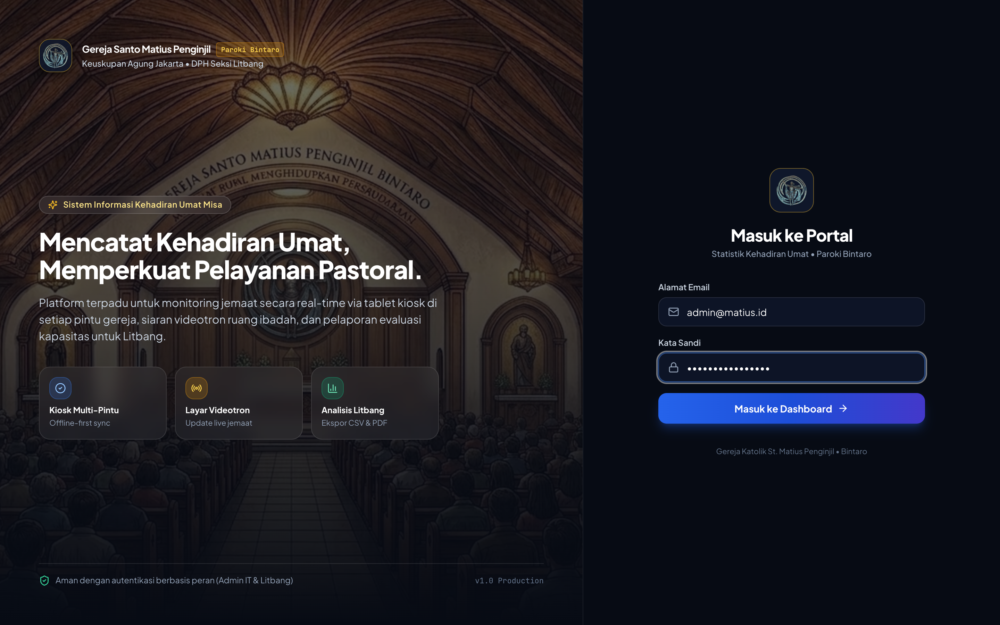

---

## 4. Langkah 2: Dashboard Utama Manajemen Acara & Misa

Setelah berhasil masuk, Anda akan diarahkan ke halaman **Manajemen Acara & Misa**. Pada halaman ini terdapat:

- **Ringkasan Statistik Cepat (4 Kartu Atas):** Menampilkan jumlah *Total Acara*, sesi *Sedang Berlangsung (Live)*, sesi *Terjadwal*, dan sesi *Selesai*.
- **Filter Status:** Memudahkan penyaringan acara berdasarkan status (`Semua`, `Live (Open)`, `Terjadwal`, atau `Selesai`).
- **Kartu Acara / Misa (Contoh: *Misa HUT Paroki ke-43*):** Setiap kartu menampilkan:
  - Status sesi (`LIVE (OPEN)`, `Terjadwal`, atau `Selesai`).
  - Nama Misa/Kegiatan, jadwal waktu mulai, serta jumlah Pos Pintu aktif (`5 Pos Pintu`).
  - Target kapasitas total kursi beserta jumlah area gedung yang dipantau (contoh: `70 kursi • 2 area` yaitu **Gedung Gereja Utama** dan **Tenda & Selasar Luar**).
  - **Tautan QR Pos Petugas Masuk:** Deretan tombol cepat untuk memunculkan QR Code tiap pintu.
  - **Tombol Aksi Bawah:** `VideoTron`, `Monitor & Pos`, `PDF`, `CSV`, serta tombol `Buka Sesi` / `Tutup Sesi`.

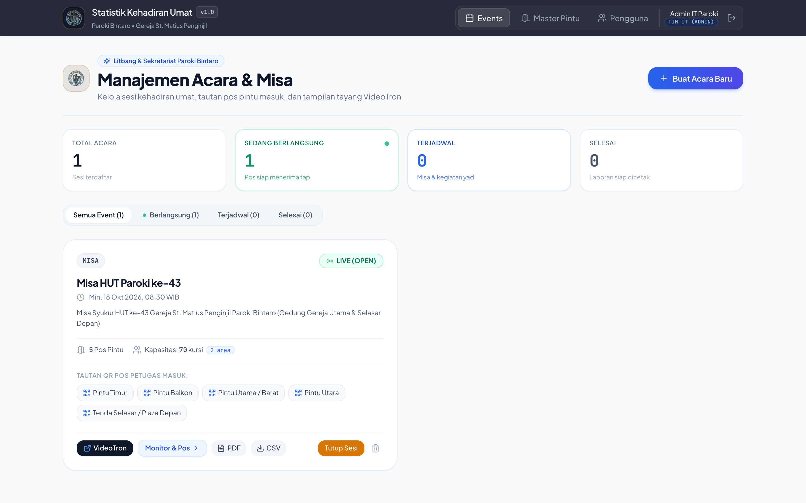

---

## 5. Langkah 3: Membuat Jadwal Baru & Mengatur Kapasitas Kursi per Ruangan

Untuk menambahkan jadwal Misa Mingguan, Misa HUT Paroki, atau kegiatan lainnya:

1. Klik tombol biru **"+ Buat Acara Baru"** di pojok kanan atas dashboard.
2. Isi informasi dasar acara:
   - **Nama Acara / Event:** Contoh: *Misa HUT Paroki ke-43*.
   - **Kategori Acara:** Pilih kategori (*Misa*, *Gladi Bersih*, *Pelantikan*, *Seminar*, *Perayaan*, atau *Lainnya*).
   - **Waktu Mulai:** Tentukan tanggal dan jam mulai acara.
   - **Keterangan Tambahan (Opsional):** Catatan untuk panitia atau petugas.
3. **Pilih Pos Pintu Masuk Sesuai Area yang Digunakan:**
   - Di bagian bawah form, pilih hanya pintu-pintu pada area yang dibuka untuk acara tersebut.
   - Sebagai contoh pada **Misa HUT Paroki ke-43** yang hanya menggunakan **Gedung Gereja Utama** dan **Tenda & Selasar Luar** (tanpa GKP):
     - Klik **"Pilih Zona Ini"** pada **Gedung Gereja Utama** (4 pintu: *Pintu Utama / Barat*, *Pintu Timur*, *Pintu Utara*, *Pintu Balkon*).
     - Centang **Tenda Selasar / Plaza Depan** pada zona **Tenda & Selasar Luar**.
4. **Aktifkan Peringatan Kapasitas Kursi per Ruangan / Area (Sangat Direkomendasikan):**
   - Centang kotak **"Aktifkan Peringatan Kapasitas Kursi per Ruangan / Area"**.
   - Sistem secara otomatis menampilkan kolom input kapasitas hanya untuk **gedung/ruangan yang pintunya dipilih** (misalnya: *Gedung Gereja Utama = 45 kursi* dan *Tenda & Selasar Luar = 25 kursi*, total otomatis *70 kursi*).
   - Ambang batas peringatan (**$\ge 75\%$ Mendekati Penuh** dan **$\ge 95\%$ Penuh**) akan dievaluasi secara mandiri per ruangan.
5. Klik tombol **"Simpan & Buat Sesi"**.

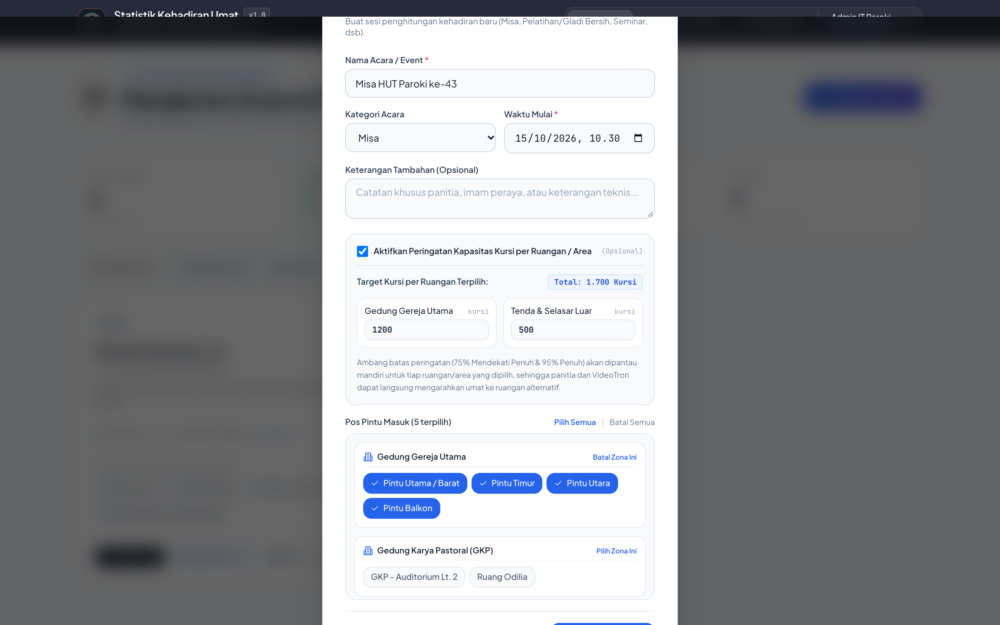

---

## 6. Langkah 4: Membagikan Akses Kiosk ke Petugas Pintu (QR Code)

Petugas pencatat di pintu masuk (**Usher / Tatib**) **tidak perlu memiliki akun atau kata sandi**. Untuk membagikan akses ke smartphone petugas:

1. Pastikan status acara sudah dibuka (**`LIVE (OPEN)`**). Jika masih berstatus *Terjadwal*, klik tombol hijau **"Buka Sesi"** pada kartu acara.
2. Pada bagian **"Tautan QR Pos Petugas Masuk"**, klik nama pintu yang dijaga oleh petugas tersebut (contoh: **`Pintu Utama / Barat`**).
3. Jendela **QR Code Pos Pintu** akan tampil di layar beserta tautan langsungnya:  
   [`https://litbang-survey.parokibintaro.org/pos/eb6e989c2d294833`](https://litbang-survey.parokibintaro.org/pos/eb6e989c2d294833)
4. Petugas cukup memindai (*scan*) QR Code tersebut menggunakan kamera HP, atau koordinator dapat mengklik **"Salin Tautan Pos"** lalu mengirimkan daftar tautan pos ke grup WhatsApp petugas tatib.

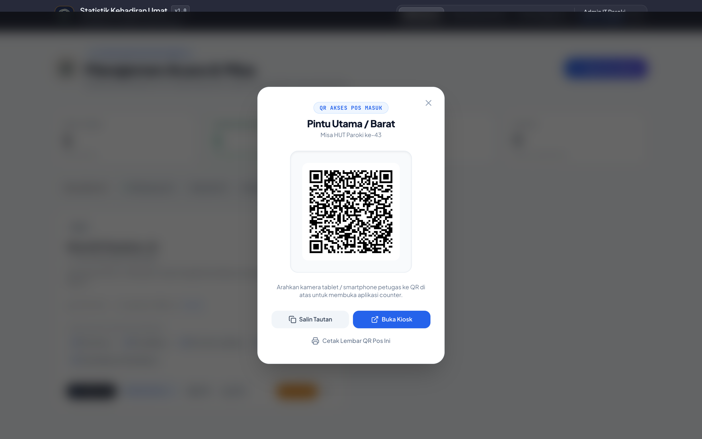

---

## 7. Langkah 5: Pencatatan Kehadiran oleh Petugas Pintu (Layar Kiosk Mobile)

Saat petugas pintu membuka tautan pos di smartphone mereka (misalnya [`https://litbang-survey.parokibintaro.org/pos/eb6e989c2d294833`](https://litbang-survey.parokibintaro.org/pos/eb6e989c2d294833) untuk **Pintu Utama / Barat** atau [`https://litbang-survey.parokibintaro.org/pos/044f076a647a425d`](https://litbang-survey.parokibintaro.org/pos/044f076a647a425d) untuk **Tenda Selasar / Plaza Depan**):

1. Pastikan nama pintu di bagian atas layar sudah sesuai dengan lokasi jaga petugas (contoh: **Pintu Utama / Barat — Gedung Gereja Utama**).
2. Setiap kali seorang umat melewati pintu masuk, petugas menekan salah satu dari dua tombol besar di layar:
   - Tombol Biru **"UMAT PAROKI BINTARO"** — untuk umat warga Paroki Bintaro.
   - Tombol Kuning/Amber **"UMAT LUAR PAROKI"** — untuk umat tamu atau peziarah dari luar paroki.
3. **Koreksi Kesalahan Ketuk (*Undo*):**
   - Jika tidak sengaja terpencet dua kali, tekan tombol **"Batalkan Ketukan Terakhir (Undo)"** di bagian bawah layar untuk mengurangi 1 hitungan terakhir dari pintu tersebut.
4. **Dukungan Offline Otomatis (*Offline-First*):**
   - Apabila sinyal seluler atau Wi-Fi di area pintu gereja sempat terputus, petugas **tetap dapat menekan tombol seperti biasa**.
   - Ketukan akan disimpan di memori HP (*Antrean Offline*) dan otomatis dikirim ke server begitu koneksi kembali stabil.

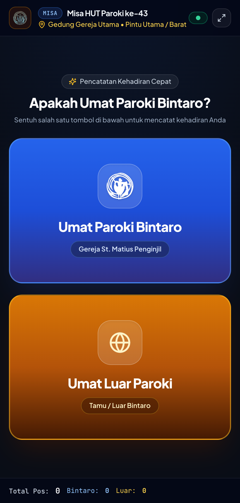

---

## 8. Langkah 6: Pemantauan Statistik & Peringatan Kapasitas Real-Time

Untuk memantau jalannya pencatatan kehadiran secara mendalam dari ruang sekretariat/koordinator (Tautan langsung demo: [`https://litbang-survey.parokibintaro.org/admin/events/88722081-da96-4dd6-a0e2-187e1c6fc49f`](https://litbang-survey.parokibintaro.org/admin/events/88722081-da96-4dd6-a0e2-187e1c6fc49f)):

1. Pada kartu acara di Dashboard Utama, klik tombol **"Monitor & Pos"**.
2. Halaman **Detail & Monitor Acara** akan menampilkan data yang diperbarui otomatis setiap beberapa detik:
   - **Banner Peringatan Kapasitas Ruangan:** Muncul otomatis berwarna **Kuning (Waspada $\ge 75\%$)** atau **Merah Berkedip (Penuh $\ge 95\%$)** beserta nama area gedung yang mendekati penuh. Pada contoh *Misa HUT Paroki ke-43*, **Gedung Gereja Utama** telah terisi **36 dari 45 kursi (`80%`)** sehingga sistem memunculkan peringatan agar petugas tatib bersiap mengarahkan umat ke **Tenda & Selasar Luar** (`14 dari 25 kursi / 56%`).
   - **4 Kartu Indikator Utama (KPI):** *Total Umat Hadir* (`50`), *Umat Paroki Bintaro* (`40` / `80%`), *Umat Luar Paroki* (`10` / `20%`), dan *Kapasitas Kursi* (`71,4%` dari total `70` kursi).
   - **Distribusi Kehadiran per Gedung & Zona:** Menampilkan keterisian kursi per gedung lengkap dengan indikator progres warna dan badge status (`≥75%` atau `PENUH`).

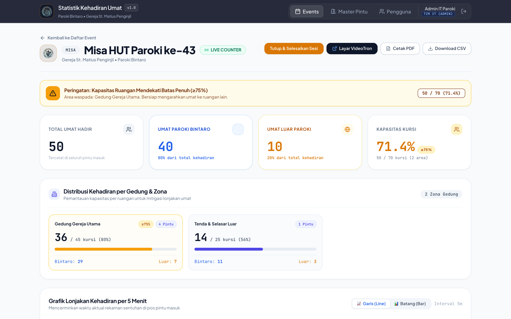

3. Gulir (*scroll*) ke bagian bawah halaman untuk melihat:
   - **Grafik Lonjakan Kehadiran per 5 Menit:** Menampilkan kurva waktu kedatangan umat dalam interval 5 menit (`08:00` s/d `08:30`). Sangat berguna untuk mengetahui kapan puncak arus kedatangan umat terjadi.
   - **Daftar Pos Pintu Aktif & Tambah Pintu Dadakan:** Menampilkan rincian angka per pintu masuk (beserta tautan langsung `/pos/{token}` yang bisa diklik atau ditampilkan QR-nya) serta form untuk menambahkan pintu/area baru secara langsung jika terjadi lonjakan umat di lapangan.

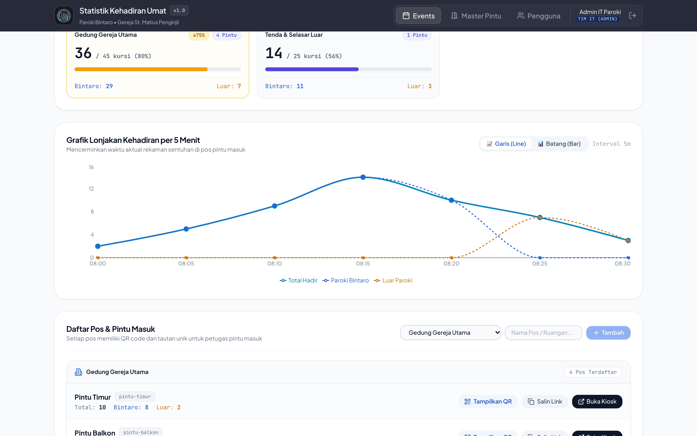

---

## 9. Langkah 7: Menayangkan Layar Videotron / TV Proyektor

Aplikasi menyediakan tampilan khusus layar lebar (*dark mode* kontras tinggi) untuk ditayangkan di TV ruang panitia, posko keamanan, atau proyektor:

1. Klik tombol hitam **"VideoTron"** pada kartu acara atau buka langsung tautan publik:  
   **[`https://litbang-survey.parokibintaro.org/videotron/88722081-da96-4dd6-a0e2-187e1c6fc49f`](https://litbang-survey.parokibintaro.org/videotron/88722081-da96-4dd6-a0e2-187e1c6fc49f)**
2. Anda dapat memilih mode tampilan di pojok kanan atas:
   - **Split View:** Menampilkan angka raksasa di sisi kiri (`50 Total Umat Hadir`, `40 Paroki Bintaro`, `10 Luar Paroki`) dan grafik kurva 5-menit di sisi kanan.
   - **Angka Saja:** Fokus pada angka kehadiran berukuran ekstra besar.
   - **Grafik Saja:** Fokus pada grafik tren kedatangan umat.
3. Klik ikon **Layar Penuh (*Fullscreen*)** di pojok kanan atas untuk menyembunyikan bilah alamat browser.
4. Di bagian bawah (*footer*), terdapat rincian per **Gedung / Zona** lengkap dengan persentase kapasitas kursi dan status peringatan (`≥75%` pada *Gedung Gereja Utama*) serta rincian tiap pintu masuk.

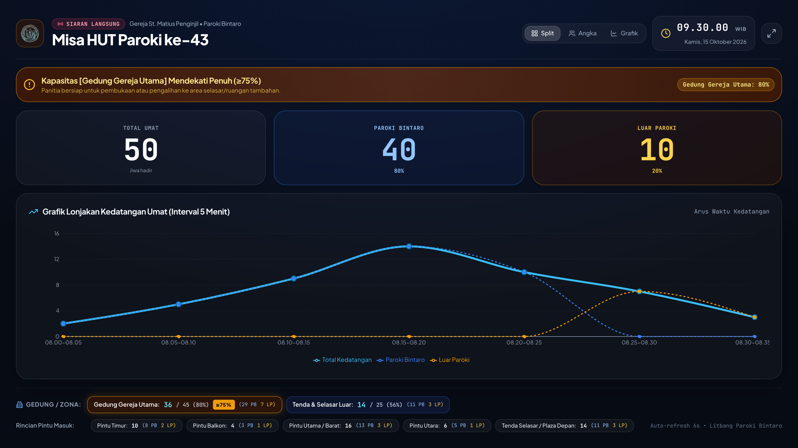

---

## 10. Langkah 8: Catatan Evaluasi, Cetak Laporan PDF, & Unduh Data CSV

Setelah misa atau kegiatan selesai dilaksanakan, Tim Litbang dapat mendokumentasikan hasil evaluasi dan mengunduh laporan resmi:

1. **Mengunduh Data Mentah Excel (CSV):**
   - Klik tombol **"Download CSV"** pada halaman detail acara (atau tombol **"CSV"** di kartu dashboard).
   - File CSV berisi ringkasan eksekutif, rincian kehadiran per gedung & pintu masuk, distribusi per 5 menit, hingga seluruh log waktu ketukan individual.
2. **Menyusun Catatan Evaluasi & Mencetak Laporan Resmi PDF:**
   - Klik tombol **"Cetak PDF"** pada halaman detail acara (Tautan langsung: [`https://litbang-survey.parokibintaro.org/admin/events/88722081-da96-4dd6-a0e2-187e1c6fc49f/report`](https://litbang-survey.parokibintaro.org/admin/events/88722081-da96-4dd6-a0e2-187e1c6fc49f/report)).
   - Pada panel kontrol di bagian atas halaman laporan, Tim Litbang dapat:
     - Mengunggah **Foto Dokumentasi Suasana Umat** di lapangan.
     - Menambahkan poin-poin **Observasi Lapangan** berdasarkan kategori (*Tata Ruang*, *Tata Laksana*, *Lain-lain*).
     - Mengisi **Rekomendasi Tindak Lanjut** dan **Kesimpulan Evaluasi**.
   - Klik **"Simpan Evaluasi"** untuk menyimpan catatan ke database.
   - Klik tombol biru **"Cetak / Simpan PDF"** untuk mencetak dokumen ke kertas A4 atau menyimpannya sebagai file PDF resmi ber-kop Gereja St. Matius Penginjil Paroki Bintaro.

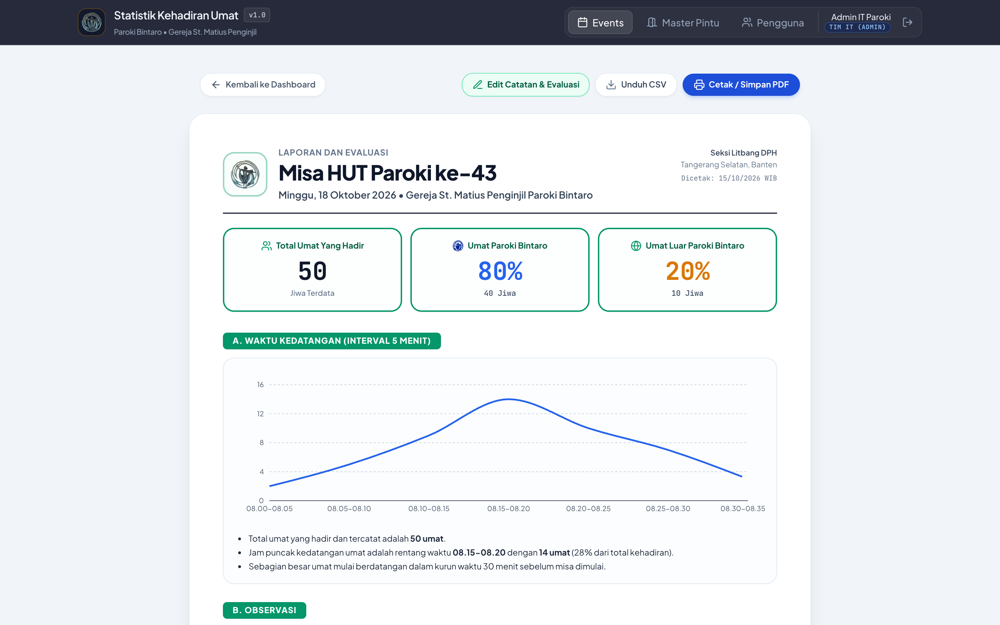

---

## 11. Langkah 9: Pengelolaan Master Pos Pintu & Gedung (Admin IT)

Khusus pengguna dengan peran **TIM IT (ADMIN)**, Anda dapat mengatur daftar standar gedung/zona dan pintu masuk gereja yang akan muncul otomatis setiap kali membuat jadwal baru:

1. Klik menu **"Master Pintu"** pada bilah navigasi atas.
2. Untuk menambahkan pintu baru:
   - Pilih atau ketik nama **Gedung / Zona Area** (contoh: *Gedung Gereja Utama*, *Gedung Karya Pastoral (GKP)*, *Tenda & Selasar Luar*).
   - Masukkan **Nama Pintu / Pos**, **Kode Unik**, **Urutan Tampil**, serta deskripsi lokasi.
   - Klik **"Tambah Master Pos"**.
3. Anda juga dapat mengubah status **Aktif / Nonaktif** atau menghapus pintu yang sudah tidak digunakan.

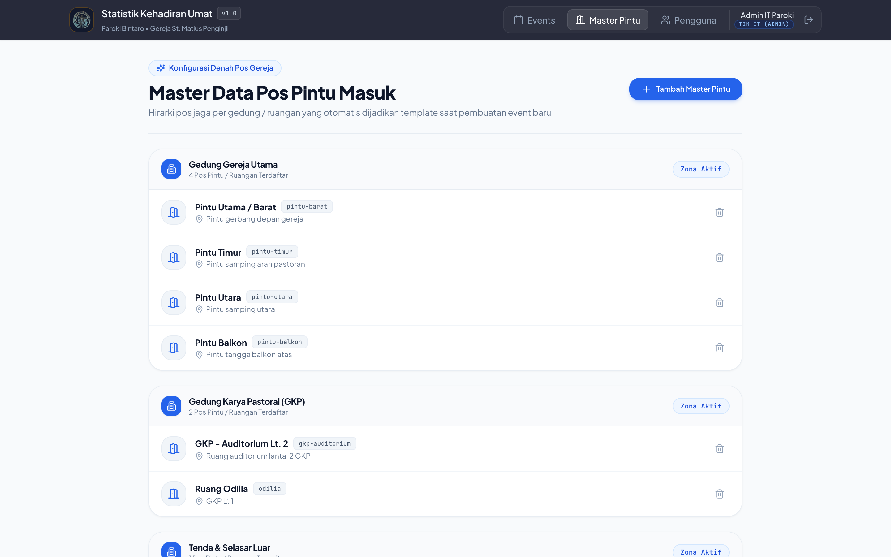

---

## 12. Langkah 10: Manajemen Akun Pengguna (Admin IT)

Untuk menambah anggota Tim Litbang baru atau mereset kata sandi pengurus:

1. Klik menu **"Pengguna"** pada bilah navigasi atas.
2. Klik tombol **"+ Tambah Pengguna"** untuk mendaftarkan akun baru:
   - Isi **Nama Lengkap**, **Alamat Email**, **Kata Sandi**, dan pilih **Peran (Role)**: `LITBANG` atau `ADMIN`.
3. Untuk mengganti kata sandi pengguna yang lupa password (atau mengganti password bawaan admin/litbang langsung dari web), klik ikon **Kunci (Reset Password)** pada baris pengguna terkait.

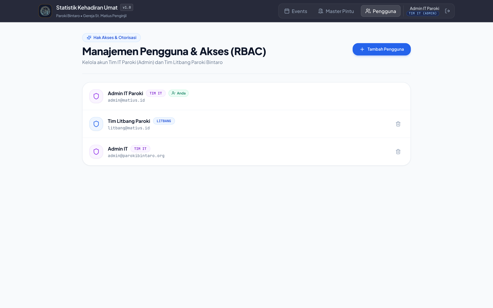

---

## 13. Tanya Jawab (FAQ) & Prosedur Kondisi Darurat

### Q1: Bagaimana jika lebih dari satu petugas menjaga pintu yang sama?
**Jawab:** Sangat bisa. Dua atau lebih petugas di pintu yang sama dapat memindai QR Code pintu yang sama di HP masing-masing (misalnya sama-sama membuka `/pos/eb6e989c2d294833`). Semua ketukan dari HP mereka akan dijumlahkan secara akurat dan *real-time* pada pintu tersebut.

### Q2: Bagaimana jika di tengah Misa dibuka tenda/ruangan tambahan dadakan?
**Jawab:** Koordinator cukup membuka halaman **Monitor & Pos** pada acara yang sedang berlangsung, gulir ke bagian bawah (**"Tambah Pintu / Pos Baru ke Sesi Ini"**), pilih Gedung/Zona, ketik nama pos baru, lalu klik **"+ Tambah Pos"**. QR Code untuk pos baru tersebut langsung siap dipindai oleh petugas.

### Q3: Apa arti warna indikator kapasitas pada gedung/ruangan?
- **Biru / Normal ($< 75\%$):** Kursi di ruangan tersebut masih longgar (contoh: *Tenda & Selasar Luar* pada `56%`).
- **Kuning / Waspada ($\ge 75\%$):** Kursi sudah terisi tiga perempat penuh (contoh: *Gedung Gereja Utama* pada `80%`); petugas tatib bersiap mengarahkan umat yang baru datang ke pintu/gedung alternatif.
- **Merah Berkedip / Penuh ($\ge 95\%$):** Ruangan sudah penuh; segera alihkan arus umat ke area cadangan.

---
*Disusun oleh Tim IT & Seksi Litbang Gereja Santo Matius Penginjil — Paroki Bintaro (2026)*
