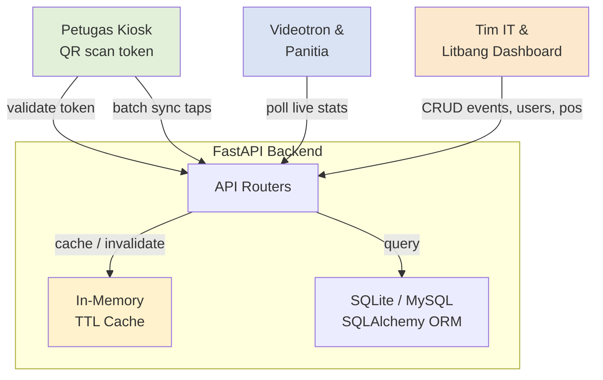
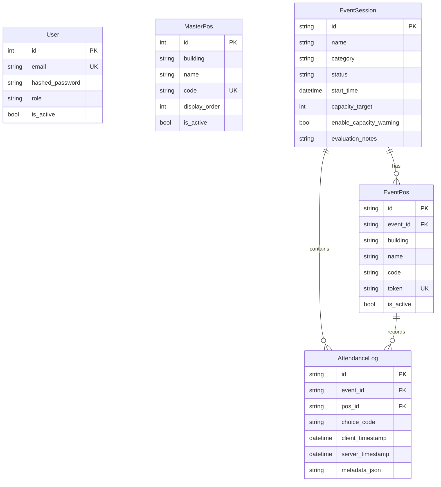
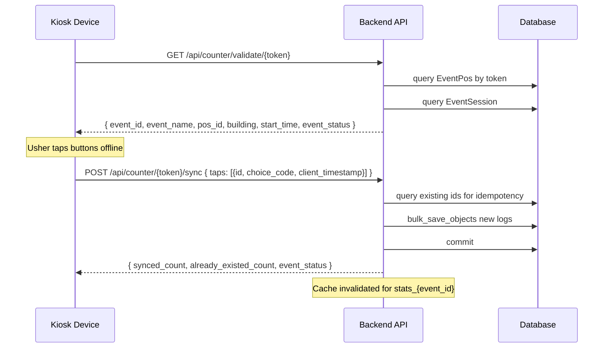
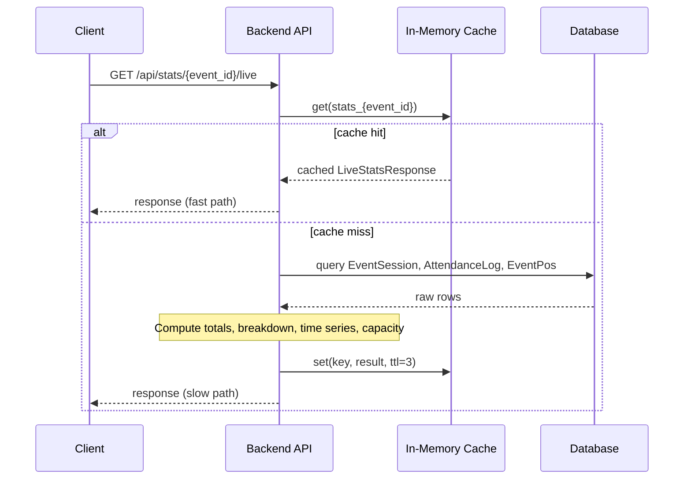
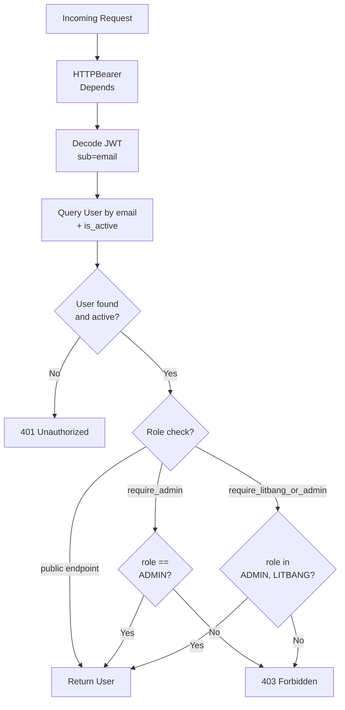

# Backend Overview

## Application purpose

The backend is a RESTful API for a real-time church congregation attendance
counter. It serves three user groups:

1. **Petugas Kiosk (ushers)** at each door -- authenticate via a QR code token
   (no login), tap "Umat Paroki Bintaro" or "Umat Luar Paroki", and sync
   offline-held taps in batches.
2. **Panitia / Videotron** -- poll live aggregated stats (total, paroki/luar
   breakdown, per-building, 15-minute time series, capacity alerts).
3. **Tim IT / Litbang** -- manage events, master door positions, users, and
   generate CSV exports and evaluation reports.



*Caption: Three client roles talking to the FastAPI backend, which mediates
between an in-memory TTL cache and an SQLAlchemy-backed database.*

## Entrypoint and application factory

The FastAPI application is constructed at module level in
`/app/main.py` so that ASGI servers (uvicorn, Passenger via a2wsgi) can import
it directly:

```python
app = FastAPI(
    title=settings.APP_NAME,
    description="...",
    version="1.0.0",
    lifespan=lifespan
)
```

### cPanel Passenger deployment

`/passenger_wsgi.py` adapts the ASGI app to WSGI via the `a2wsgi` library:

```python
from a2wsgi import ASGIMiddleware
from app.main import app
application = ASGIMiddleware(app)
```

Phusion Passenger calls the `application` callable. This is the only supported
production deployment path (see related page
[/openwiki/operations/deployment-cpanel.md](/openwiki/operations/deployment-cpanel.md)).

## Lifespan: startup seeding

The `lifespan` async context manager runs `init_db_and_seed()` on startup:

1. **Create all tables**: `Base.metadata.create_all(bind=engine)` -- safe to run
   every time; no-op if tables exist.
2. **Seed admin user** (`admin@matius.id`, role `ADMIN`) if not present.
3. **Seed litbang user** (`litbang@matius.id`, role `LITBANG`) if not present.
4. **Seed MasterPos defaults** -- seven door positions across three buildings
   (Gedung Gereja Utama, Gedung Karya Pastoral, Tenda & Selasar Luar), each
   with a unique `code` identifier.

No shutdown logic is required. The `init_db_and_seed()` function is also
imported directly by the test suite to set up the test database.

## Configuration

`/app/config.py` uses Pydantic Settings v2 to load from environment variables
or `.env` file:

| Setting | Default | Description |
|---|---|---|
| `DATABASE_URL` | `sqlite:///./statistik_umat.db` | SQLite for development; MySQL+pymysql for cPanel |
| `SECRET_KEY` | (project default) | JWT signing key |
| `ALGORITHM` | `HS256` | JWT algorithm |
| `ACCESS_TOKEN_EXPIRE_MINUTES` | 1440 (24h) | Token lifetime |
| `CACHE_TTL_SECONDS` | 3 | Stats cache TTL |
| `INITIAL_ADMIN_EMAIL` / `PASSWORD` | `admin@matius.id` | Seeded on first run |
| `INITIAL_LITBANG_EMAIL` / `PASSWORD` | `litbang@matius.id` | Seeded on first run |
| `APP_NAME` / `PARISH_NAME` | (human-readable) | Used in responses and page titles |

The `model_config` enables `extra="allow"` so additional env vars do not cause
errors.

## Database layer

`/app/database.py` provides:

- **`engine`**: SQLAlchemy engine created from `settings.DATABASE_URL`. For
  SQLite, `check_same_thread=False` is set so the same engine can be shared
  across requests.
- **`SessionLocal`**: `sessionmaker` bound to the engine.
- **`Base`**: `declarative_base()` for ORM models.
- **`get_db()`**: FastAPI dependency that yields a session and closes it in a
  `finally` block.

### SQLAlchemy model overview

`/app/models.py` defines four tables:

| Model | Table | Key columns | Relationships |
|---|---|---|---|
| `User` | `users` | `id`, `email`, `hashed_password`, `role` (`ADMIN`/`LITBANG`), `is_active` | - |
| `MasterPos` | `master_pos` | `id`, `building`, `name`, `code` (unique), `display_order`, `is_active` | - |
| `EventSession` | `event_sessions` | `id` (UUID string), `name`, `status` (`SCHEDULED`/`OPEN`/`COMPLETED`), `start_time`, `capacity_target`, `evaluation_notes` (JSON string) | `pos_list`, `attendance_logs` (cascade delete) |
| `EventPos` | `event_pos` | `id` (UUID string), `event_id` (FK), `building`, `name`, `code`, `token` (unique, used for QR auth) | `event`, `attendance_logs` (cascade delete) |
| `AttendanceLog` | `attendance_logs` | `id` (UUID string, PK -- client-provided for idempotency), `event_id` (FK), `pos_id` (FK), `choice_code`, `client_timestamp`, `server_timestamp`, `metadata_json` | `event`, `pos` |



*Caption: ER diagram of the five database tables. EventPos and AttendanceLog
cascade-delete with their parent EventSession.*

### Key model invariants

- `AttendanceLog.id` is a **client-generated UUID** supplied at sync time.
  This is the idempotency key: re-syncing the same tap UUID silently skips
  without error or duplication.
- `EventPos.token` is a random hex string used as a bearer-like credential for
  kiosk devices. It is the only authentication for the counter endpoints.
- `EventSession.status` transitions are constrained by the application layer,
  not database triggers: only `SCHEDULED` → `OPEN` → `COMPLETED` are accepted.
- `EventSession.evaluation_notes` stores a JSON-serialized string of
  `EvaluationNotes` (observations list, recommendations, conclusion, photo URL).

## In-memory TTL cache

`/app/cache.py` provides a thread-safe, in-memory key-value cache with TTL
expiry:

```python
stats_cache = SimpleTTLCache(default_ttl=3)
```

- **Default TTL**: 3 seconds (configurable via `CACHE_TTL_SECONDS`).
- **Thread safety**: All reads and writes acquire a `threading.Lock`.
- **Cache keys**: Prefix `stats_{event_id}` is used by the live stats endpoint.
- **Invalidation**: `invalidate(prefix)` clears all keys starting with the
  given prefix. Called on event status change, event update, evaluation notes
  update, and each batch sync.
- **Purpose**: Prevents database hammering when multiple videotron displays and
  panitia smartphones poll `/api/stats/{event_id}/live` simultaneously.

## CORS middleware

```python
app.add_middleware(
    CORSMiddleware,
    allow_origins=["*"],
    allow_credentials=True,
    allow_methods=["*"],
    allow_headers=["*"],
)
```

A permissive CORS policy is applied since the frontend SPA may be served from a
different origin than the API (e.g., during development). The `allow_origins`
setting is a candidate for tightening in production.

## API router structure

The application includes five routers, each mounted at a distinct prefix:

| Router | Prefix | Auth required | Key endpoints |
|---|---|---|---|
| `auth` | `/api/auth` | Mixed | `POST /login`, `GET /me`, `CRUD /users` |
| `master_pos` | `/api/master-pos` | Litbang/Admin | `GET`, `POST`, `PUT`, `DELETE` |
| `misa` (events) | `/api/events` | Litbang/Admin | CRUD events, status transitions, evaluation notes |
| `counter` | `/api/counter` | Token (none) | `GET /validate/{token}`, `POST /{token}/sync` |
| `stats` | `/api/stats` | None | `GET /{event_id}/live`, `GET /{event_id}/export/csv` |

### 1. Auth router (`/app/routers/auth.py`)

- **`POST /api/auth/login`**: Accepts email + password, verifies bcrypt hash,
  returns JWT and user info. The JWT payload contains `sub` (email) and `role`.
  Inactive users receive HTTP 403.
- **`GET /api/auth/me`**: Returns the authenticated user's profile.
- **`GET /api/auth/users`** (admin only): Lists all users.
- **`POST /api/auth/users`** (admin only): Creates new users; validates no
  duplicate email and that role is one of `ADMIN` / `LITBANG`.
- **`PUT /api/auth/users/{id}`** (admin only): Updates user fields. Passwords
  are re-hashed with bcrypt on change.

### 2. MasterPos router (`/app/routers/master_pos.py`)

CRUD for the master door/position registry. Used as a template when creating
new event sessions. Supports optional `active_only` filtering.

### 3. Events router (`/app/routers/misa.py`)

- **`POST /api/events`**: Creates an event session (e.g., "Misa Natal I"). On
  creation, the endpoint populates `EventPos` rows by one of three strategies:
  1. **Selected master pos IDs**: Copy from `MasterPos` table by primary key.
  2. **Custom names**: Create ad-hoc positions with auto-generated `code`.
  3. **Default fallback**: If neither option is provided, copy all active
     `MasterPos` rows, or fall back to four hardcoded defaults if the master
     table is empty.
- **`PUT /api/events/{id}/status`**: Transition event status (scheduled →
  open → completed). Invalidates the stats cache for that event.
- **`PUT /api/events/{id}/evaluation-notes`**: Stores a structured JSON
  evaluation (observations, recommendations, conclusion) serialized into the
  `evaluation_notes` text column.

### 4. Counter router (`/app/routers/counter.py`) -- offline-first sync

This is the most important router for the kiosk workflow:



*Caption: Kiosk token validation followed by a batch sync of tapped attendance
logs. Idempotency is guaranteed by the client-provided UUID.*

Key behaviors:

- **Token validation** (`/validate/{token}`): Lookup by `EventPos.token`.
  Returns event metadata used by the kiosk to display the event name and verify
  the door assignment. No authentication dependency -- the token itself is the
  credential.
- **Batch sync** (`/{token}/sync`):
  - Rejects taps if `event.status == COMPLETED`.
  - Queries all incoming `id` values against `AttendanceLog` to skip duplicates
    (idempotency).
  - Uses `db.bulk_save_objects` for performance.
  - Invalidates `stats_cache` for the event so pollers see fresh data.
- The endpoint does NOT require a JWT -- only the `EventPos.token`.

### 5. Stats router (`/app/routers/stats.py`) -- real-time aggregation

- **`GET /api/stats/{event_id}/live`**:
  - Checks `stats_cache` first; returns cached response within TTL.
  - Computes total, paroki/luar counts and percentages, per-pos breakdown,
    per-building rollup, and 15-minute time-series buckets from
    `client_timestamp`.
  - Evaluates capacity: `NORMAL` (<75%), `WARNING` (75-94%), `FULL` (≥95%).
  - Stores result in cache with TTL before returning.
- **`GET /api/stats/{event_id}/export/csv`**:
  - Streams a CSV with columns: ID_Tap, Nama_Event, Gedung_Lokasi,
    Nama_Pos_Pintu, Pilihan_Umat, Waktu_Sentuh_Lokal, Waktu_Diterima_Server,
    Metadata_Tambahan.



*Caption: Cache-first pattern for live stats. Under high concurrency, pollers
hit the 3-second TTL cache instead of the database.*

## SPA fallback serving

`/app/main.py` serves the built React frontend from `app/static/`:

1. If `app/static/assets/` exists, mount it as a static files directory at
   `/assets`.
2. A catch-all `GET /{full_path:path}` handler:
   - Rejects `api/` prefixed paths with 404 (letting API routers match first).
   - Returns the exact file if found on disk (e.g., favicon, robots.txt).
   - Otherwise returns `app/static/index.html` -- the SPA entry point that
     handles client-side routing.
   - If no frontend build exists, returns a JSON welcome message.

This ensures that client-side routes like `/pos/{token}` or
`/videotron/{event_id}` resolve to the SPA without server-side URL rewriting.

## Auth / auth dependency chain

`/app/auth.py` implements a simple role-based access control (RBAC) chain:

```
HTTPBearer → get_current_user → require_admin | require_litbang_or_admin
```

- **`get_current_user()`**: Decodes the JWT, extracts `sub` (email), queries
  the user from the database, verifies `is_active`. Returns `User` or raises
  HTTP 401.
- **`require_admin()`**: Calls `get_current_user()`, checks `role == ADMIN`.
  Raises HTTP 403 otherwise.
- **`require_litbang_or_admin()`**: Calls `get_current_user()`, checks role is
  `ADMIN` or `LITBANG`. Raises HTTP 403 otherwise.



*Caption: JWT-based auth dependency chain. `require_admin` and
`require_litbang_or_admin` build on `get_current_user`.*

## Health check

```
GET /api/health → {"status": "ok", "app_name": "...", "parish": "..."}
```

Defined inline in `main.py`, no auth required. Used by monitoring and by
frontend to verify API reachability.

## Testing strategy

`/tests/test_api.py` uses `pytest` with `TestClient` from FastAPI and a
separate SQLite test database (`test_app.db`):

- **`setup_database` fixture** (module scope): Drops and recreates all tables,
  seeds users and one master pos. Runs once per module.
- **Dependency override**: `app.dependency_overrides[get_db]` substitutes the
  test session factory, isolating tests from the development database.
- **Test coverage**:
  - Health check (`test_health_check`)
  - Login and auth flow (`test_login_and_auth`)
  - Full create-event→validate-pos→sync-taps→check-stats→export-CSV flow
    (`test_create_event_and_counter_flow`)
  - Idempotency: re-syncing the same taps returns `synced_count=0` and
    `already_existed_count=N`
  - SPA fallback for `/` and `/pos/{token}` and `/videotron/{id}`
    (`test_spa_fallback_and_static_serving`)
  - MasterPos CRUD and user management (`test_master_pos_and_user_management`)
  - Evaluation notes save/verify (`test_evaluation_notes_flow`)

## Relationship to other pages

| Related page | Relationship |
|---|---|---|
| [/openwiki/architecture/data-model.md](/openwiki/architecture/data-model.md) | Detailed column types, indexes, and migration history for the SQLAlchemy models summarised here. |
| [/openwiki/concepts/attendance-flow.md](/openwiki/concepts/attendance-flow.md) | End-to-end user journey: kiosk tap, offline queue, batch sync, live stats poll, CSV export. |
| [/openwiki/operations/deployment-cpanel.md](/openwiki/operations/deployment-cpanel.md) | Production deployment via Phusion Passenger and a2wsgi, MySQL migration, environment setup. |
| [/openwiki/architecture/authentication.md](/openwiki/architecture/authentication.md) | Detailed JWT token lifecycle, bcrypt password hashing, and RBAC role definitions. |
