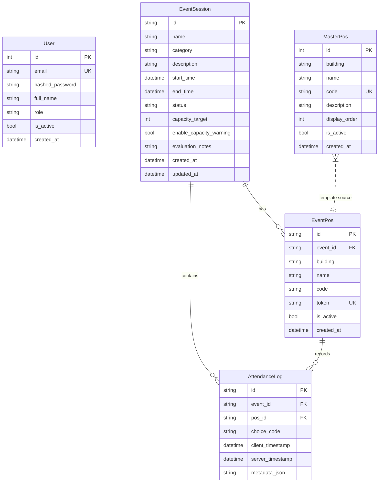

# Data Model

## Overview

The application uses five SQLAlchemy ORM models that together capture a
parish's event-driven attendance workflow: administrators define **master door
positions** (the catalog of physical door locations), create **event sessions**
(Misa, seminars) each with its own **per-event door instances** (each bearing a
unique QR token), and finally record **tap logs** when ushers tally a
congregant's arrival. Two **User** roles guard write access.



*Caption: Five tables. MasterPos is a catalog template; EventPos are
per-event copies created from it. EventSession owns both EventPos and
AttendanceLog through cascade-delete relationships.*

## User

**Table:** `users`

Stores authentication and authorization for the application's administrative
interfaces. The schema uses a simple role-string column rather than a
many-to-many RBAC join table.

- **`role`** — accepts two values defined in the `UserRole` class:
  `ADMIN` (Tim IT) and `LITBANG` (Tim Litbang). `LITBANG` is the default.
- **`is_active`** — a soft-disable flag; `get_current_user` filters to
  `is_active == True`, so deactivated accounts cannot authenticate.
- **`email`** — unique, used as the JWT `sub` claim during login.
- **`hashed_password`** — bcrypt hash stored as a string.

```python
# repo://app/models.py#L22-L31
class User(Base):
    __tablename__ = "users"
    id = Column(Integer, primary_key=True, index=True)
    email = Column(String(128), unique=True, index=True, nullable=False)
    hashed_password = Column(String(255), nullable=False)
    full_name = Column(String(128), nullable=False)
    role = Column(String(32), default=UserRole.LITBANG, nullable=False)
    is_active = Column(Boolean, default=True, nullable=False)
    created_at = Column(DateTime, default=datetime.utcnow, nullable=False)
```

**Role enforcement:** Dependencies `require_admin` and
`require_litbang_or_admin` at `/app/auth.py`#L61-L74 gate all mutating
endpoints. Counter and stats endpoints are unauthenticated.

**Invariant:** There is no mechanism to recover a deleted user. The initial
seed in `init_db_and_seed()` creates two default users (admin + litbang)
from environment variables, skipping creation only if the email already
exists.

## MasterPos (Default Door Catalog)

**Table:** `master_pos`

Represents the physical door / entry-point catalog of the parish. These
records serve as templates when creating an event session.

- **`code`** — unique identifier string (e.g. `"pintu-barat"`). Enforced at
  the application layer (duplicate check in `create_master_pos`) and by a
  database `UNIQUE` constraint.
- **`building`** — grouping label added by migration
  `cd05de9ff18d_add_building_hierarchy_to_pos`. Defaults to `"Gedung Gereja
  Utama"`. Indexed for building-breakdown queries in live stats.
- **`display_order`** — ordinal for UI sorting, used together with building
  in `ORDER BY building ASC, display_order ASC`.
- **`is_active`** — soft-delete flag; inactive master doors are excluded
  when populating `EventPos` from `MasterPos` during event creation.

```python
# repo://app/models.py#L33-L43
class MasterPos(Base):
    __tablename__ = "master_pos"
    id = Column(Integer, primary_key=True, index=True)
    building = Column(String(128), default="Gedung Gereja Utama", nullable=False, index=True)
    name = Column(String(128), nullable=False)
    code = Column(String(64), unique=True, nullable=False)
    description = Column(String(255), nullable=True)
    display_order = Column(Integer, default=0, nullable=False)
    is_active = Column(Boolean, default=True, nullable=False)
    created_at = Column(DateTime, default=datetime.utcnow, nullable=False)
```

**Seeding defaults:** `init_db_and_seed()` in `/app/main.py`#L43-L65 inserts
seven default doors organized into three buildings when the master_pos table
is empty.

**Lifecycle:** MasterPos records are long-lived data. Deleting a MasterPos
has no cascade effect on existing `EventPos` records — each `EventPos` is an
independent snapshot created at event-creation time.

## EventSession

**Table:** `event_sessions`

Each mass, seminar, or special event that the parish tracks. The primary
business entity that groups door positions and attendance logs.

- **`id`** — UUID string (`String(36)`), generated server-side with
  `uuid.uuid4()`. Not a database-native UUID type; this is compatible with
  SQLite and MySQL without special column types.
- **`status`** — lifecycle enum from `EventStatus`: `SCHEDULED`,
  `OPEN`, `COMPLETED`. Transitions are controlled by the API; there is no
  automated status state machine.
- **`evaluation_notes`** — nullable `Text` column added by migration
  `e4039a3350a7_add_evaluation_notes_to_event_session`. Stores JSON-encoded
  structured notes (observations, recommendations, conclusion, photo URL).
- **`capacity_target`** / **`enable_capacity_warning`** — when enabled, live
  stats compute `capacity_percentage` and classify it as `NORMAL` (<75%),
  `WARNING` (75-95%), or `FULL` (>=95%).

```python
# repo://app/models.py#L45-L62
class EventSession(Base):
    __tablename__ = "event_sessions"
    id = Column(String(36), primary_key=True, default=lambda: str(uuid.uuid4()))
    name = Column(String(255), nullable=False)
    category = Column(String(64), default="Misa", nullable=False)
    description = Column(Text, nullable=True)
    start_time = Column(DateTime, nullable=False)
    end_time = Column(DateTime, nullable=True)
    status = Column(String(32), default=EventStatus.SCHEDULED, nullable=False)
    capacity_target = Column(Integer, nullable=True)
    enable_capacity_warning = Column(Boolean, default=False, nullable=False)
    evaluation_notes = Column(Text, nullable=True)
    created_at = Column(DateTime, default=datetime.utcnow, nullable=False)
    updated_at = Column(DateTime, default=datetime.utcnow, onupdate=datetime.utcnow, nullable=False)

    pos_list = relationship("EventPos", back_populates="event", cascade="all, delete-orphan")
    attendance_logs = relationship("AttendanceLog", back_populates="event", cascade="all, delete-orphan")
```

**Cascade delete:** Deleting an `EventSession` cascades to all its
`EventPos` and `AttendanceLog` rows (both relationships use `cascade="all,
delete-orphan"`). This matches the `ON DELETE CASCADE` foreign key
declarations on both child tables.

**Business invariant:** An event with `COMPLETED` status refuses new
attendance taps. The batch sync endpoint checks this before inserting.

## EventPos (Per-Event Door Instance)

**Table:** `event_pos`

A snapshot of a door position copied from MasterPos (or created as custom)
for a specific event session. Each EventPos carries a unique QR token that
identifies it to the kiosk counter interface.

- **`id`** — UUID string, generated server-side.
- **`event_id`** — foreign key to `EventSession.id` with `ON DELETE
  CASCADE`.
- **`token`** — unique 16-character hex string (`uuid.uuid4().hex[:16]`).
  Indexed and unique. This token is the only authentication mechanism for
  the counter endpoints — no login required.
- **`is_active`** — allows disabling a specific door instance without
  deleting it. The `/api/counter/validate/{token}` endpoint filters to
  `is_active == True`.

```python
# repo://app/models.py#L64-L77
class EventPos(Base):
    __tablename__ = "event_pos"
    id = Column(String(36), primary_key=True, default=lambda: str(uuid.uuid4()))
    event_id = Column(String(36), ForeignKey("event_sessions.id", ondelete="CASCADE"), nullable=False, index=True)
    building = Column(String(128), default="Gedung Gereja Utama", nullable=False, index=True)
    name = Column(String(128), nullable=False)
    code = Column(String(64), nullable=False)
    token = Column(String(64), unique=True, index=True, default=lambda: uuid.uuid4().hex)
    is_active = Column(Boolean, default=True, nullable=False)
    created_at = Column(DateTime, default=datetime.utcnow, nullable=False)

    event = relationship("EventSession", back_populates="pos_list")
    attendance_logs = relationship("AttendanceLog", back_populates="pos", cascade="all, delete-orphan")
```

**Population strategy at event creation:** (See `/app/routers/misa.py`#L48-L110)

1. If `selected_master_pos_ids` is provided — filter MasterPos by those IDs
   (only active ones), sorted by building and display_order.
2. Else if `custom_pos_names` is provided — create EventPos rows with
   auto-generated codes (`"pos-1"`, `"pos-2"`, ...) and building default
   `"Gedung Gereja Utama"`.
3. Else — copy all active MasterPos records. If MasterPos is empty, fall
   back to four hardcoded default doors.

**Invariant:** Multiple EventPos rows within the same event can share the
same `code` value — the `code` column is not unique on EventPos; uniqueness
applies only to `token`.

## AttendanceLog (Tap Record)

**Table:** `attendance_logs`

Each row represents one congregant count — a "tap" by an usher selecting
either "Umat Paroki Bintaro" or "Umat Luar Paroki".

- **`id`** — client-supplied UUID string (up to 64 characters). This is the
  idempotency key: the batch sync endpoint checks `AttendanceLog.id`
  against already-existing IDs before inserting, allowing safe retry of
  offline tap batches. See `/app/routers/counter.py`#L72-L73.
- **`event_id`** / **`pos_id`** — foreign keys to `EventSession` and
  `EventPos`, both with `ON DELETE CASCADE`.
- **`choice_code`** — one of `PAROKI_BINTARO` or `LUAR_PAROKI`, defined in
  the `ChoiceCode` class. Indexed for aggregation queries.
- **`client_timestamp`** — timestamp set by the kiosk device at the moment
  of tap. Indexed. Used for time-series bucketing in live stats
  (15-minute intervals).
- **`server_timestamp`** — timestamp set by `datetime.utcnow()` when the
  server processes the sync. Indexed.
- **`metadata_json`** — nullable `Text` column for future extensibility
  (e.g. device ID, scan mode).

```python
# repo://app/models.py#L79-L91
class AttendanceLog(Base):
    __tablename__ = "attendance_logs"
    id = Column(String(64), primary_key=True)
    event_id = Column(String(36), ForeignKey("event_sessions.id", ondelete="CASCADE"), nullable=False, index=True)
    pos_id = Column(String(36), ForeignKey("event_pos.id", ondelete="CASCADE"), nullable=False, index=True)
    choice_code = Column(String(64), nullable=False, index=True)
    client_timestamp = Column(DateTime, nullable=False, index=True)
    server_timestamp = Column(DateTime, default=datetime.utcnow, nullable=False, index=True)
    metadata_json = Column(Text, nullable=True)

    event = relationship("EventSession", back_populates="attendance_logs")
    pos = relationship("EventPos", back_populates="attendance_logs")
```

**Idempotency invariant:** `AttendanceLog.id` is the primary key.
Re-sending the same batch of tap items after a client timeout or network
failure will not duplicate rows; the server returns
`already_existed_count` equal to the number of skipped IDs. This is the
foundation of the offline-first sync design.

**Query patterns:** Live stats (`/app/routers/stats.py`#L32-L118) load all
`AttendanceLog` rows for an event into memory and aggregate with Python
list comprehensions. This works at current scale (single-event logs fit in
RAM). A production-scale system would push aggregation to SQL.

## Relationship summary

| Parent | Child | FK column | Cascade | Orphan? |
|--------|-------|-----------|---------|---------|
| `EventSession` | `EventPos` | `event_pos.event_id` | `ON DELETE CASCADE` | Yes (`delete-orphan`) |
| `EventSession` | `AttendanceLog` | `attendance_logs.event_id` | `ON DELETE CASCADE` | Yes (`delete-orphan`) |
| `EventPos` | `AttendanceLog` | `attendance_logs.pos_id` | `ON DELETE CASCADE` | Yes (`delete-orphan`) |
| `MasterPos` | `EventPos` | (none) | Template copy, no FK | N/A |

## Cascade delete semantics

Because `EventPos` and `AttendanceLog` both use `cascade="all,
delete-orphan"` from `EventSession`, deleting an event removes all its
child rows in a single session flush. The `ON DELETE CASCADE` foreign keys
at the database level enforce the same rule if rows are deleted directly via
SQL outside the ORM.

```python
# Deleting an event cascades:
db.delete(event)
db.commit()
# EventPos rows where event_id == event.id are removed.
# AttendanceLog rows where event_id == event.id are removed.
# AttendanceLog rows where pos_id matches any removed EventPos are also removed.
```

## Database configuration

- **Default:** SQLite via `sqlite:///./statistik_umat.db`
- **Test override:** In `/tests/test_api.py`#L18 the test fixture forces an
  in-memory SQLite database.
- **Connection args:** `check_same_thread=False` is set when the URL starts
  with `sqlite` to allow SQLAlchemy to share the connection across
  FastAPI async threads.
- **Migration state:** Three Alembic migrations exist (`e5a424868b5c`
  initial, `cd05de9ff18d` building hierarchy, `e4039a3350a7` evaluation
  notes), all linear with no branching.

## Schema evolution pattern

All schema changes follow a consistent pattern:

1. An Alembic migration adds nullable columns with `server_default` where
   needed for existing rows.
2. The Python model gets a matching Column with a default value.
3. The Pydantic schemas get an optional field.
4. The migration revision graph is linear (`e5a424868b5c` →
   `cd05de9ff18d` → `e4039a3350a7`).

## Pydantic schemas (API layer)

The schemas in `/app/schemas.py` mirror the ORM models but add validation
and documentation for the FastAPI endpoints. Key patterns:

- **`EventSessionCreate`** accepts `selected_master_pos_ids` and
  `custom_pos_names` for flexible event-creation strategies.
- **`EvaluationNotes`** defines a structured JSON schema (observations,
  recommendations, conclusion, photo URL) but the model column stores the
  encoded string.
- **`LiveStatsResponse`** aggregates across multiple models and includes
  computed fields (percentages, capacity status, time series).
- **`BatchSyncRequest`** / **`BatchSyncResponse`** model the offline tap
  sync contract.

## Constraints and edge cases

- **Token uniqueness:** `EventPos.token` has a unique constraint enforced at
  both the ORM and database level. Token collision during event creation is
  improbable with `uuid.uuid4().hex[:16]` but not impossible; the unique
  constraint will raise an `IntegrityError` if it occurs.
- **No unique constraint on EventPos.event_id + EventPos.code:** The same
  `code` (e.g. `"pintu-barat"`) can appear in multiple EventPos rows
  within the same event if two doors share a code string.
- **No cascading from MasterPos:** Deleting a `MasterPos` does not affect
  existing `EventPos` rows. The snapshot-at-creation pattern decouples
  catalog maintenance from active events.
- **Status immutability after COMPLETED:** The update endpoint validates
  status against the allowed list but does not enforce a one-way
  transition. It is possible to move a COMPLETED event back to OPEN.
- **Capacity percentage calculation:** `capacity_percentage = total_umat /
  capacity_target * 100`. If `capacity_target` is 0 or None, the
  percentage and status remain None or `"NORMAL"`.
- **Evaluation notes format:** Stored as a JSON string in a `Text` column.
  The API accepts a structured `EvaluationNotes` Pydantic model and
  serializes it with `json.dumps()`. Consumers must parse it back.
