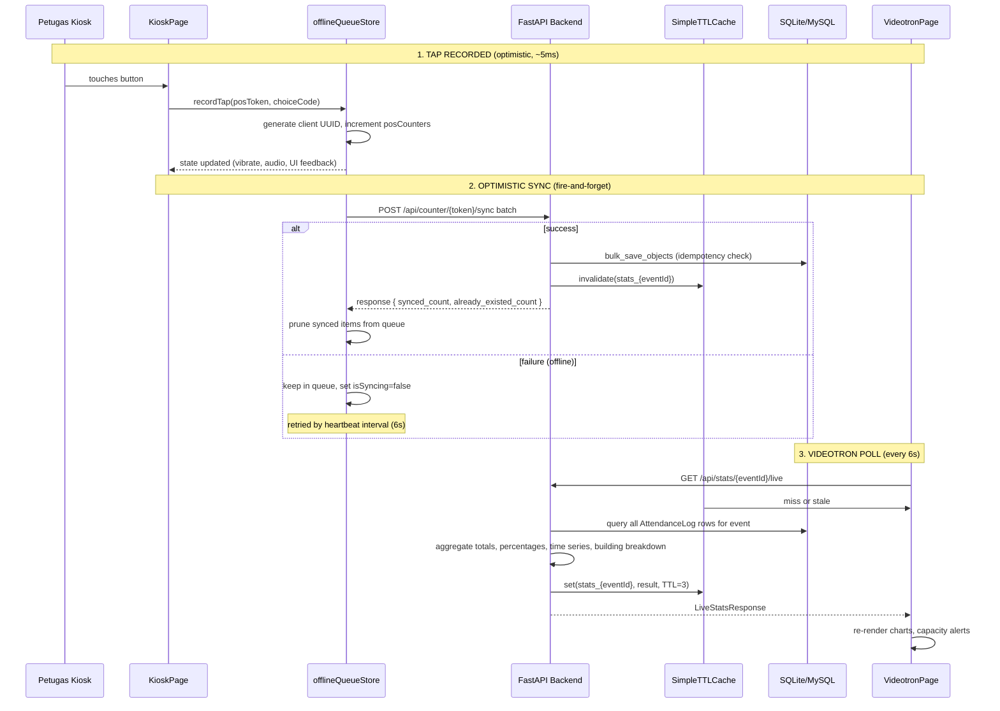
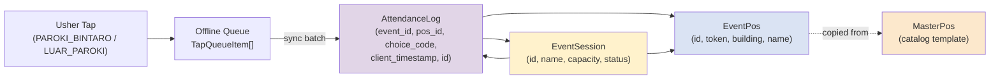
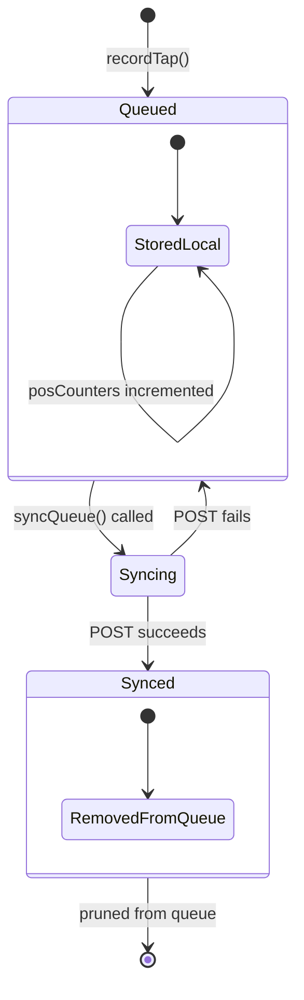

# Attendance Counting Flow

## Overview

When an usher taps "Umat Paroki Bintaro" or "Umat Luar Paroki" on a tablet
kiosk at a church entrance, the tap must be recorded instantly on screen,
survive network interruptions, arrive at the server without duplicates, and be
reflected on a Videotron display within seconds. The system achieves this
through an **offline-first, optimistic-update architecture** spanning four
layers:

1. **Kiosk frontend** (`KioskPage` + `offlineQueueStore`) -- records taps with
   zero waiting, queues them locally when offline.
2. **Batch sync API** (`/api/counter/{token}/sync`) -- accepts batches of tap
   records with idempotency guarantees.
3. **TTL cache and invalidation** (`SimpleTTLCache`) -- the sync endpoint
   invalidates cached stats; new cache populates on next read.
4. **Videotron frontend** (`VideotronPage`) -- polls `/api/stats/{event_id}/live`
   every 6 seconds for fresh aggregations.



*Caption: End-to-end sequence from usher tap to Videotron display, covering
optimistic local state, offline queue, batch sync, cache invalidation, and
polling-based stats refresh.*

## Key entrypoints and responsibilities

### KioskPage: the usher-facing touch interface

**File:** `repo://frontend/src/pages/KioskPage.tsx`

The kiosk page is rendered when the browser navigates to `/pos/{token}`.
Routing is handled by the SPA fallback in `repo://frontend/src/App.tsx#L23-L25`:

```typescript
if (path.startsWith('/pos/')) {
  const token = path.replace('/pos/', '').trim();
  return <KioskPage token={token} />;
}
```

**Responsibilities:**

- **Validate the QR token** by calling `GET /api/counter/validate/{token}` on
  mount. This endpoint returns event metadata (`event_name`, `event_status`,
  `pos_name`, `building`) and fails with 404 if the token is inactive or the
  event is not found (`repo://app/routers/counter.py#L16-L36`).
- **Render two large touch targets** -- "Umat Paroki Bintaro" and "Umat Luar
  Paroki" -- plus a local tally footer showing that door's count.
- **Guard against completed events:** if `posInfo.event_status === 'COMPLETED'`,
  the buttons are disabled (`repo://frontend/src/pages/KioskPage.tsx#L97-L97`).
- **Debounce taps** with a 500ms cooldown (`isCooldown` state) to prevent
  accidental double-taps.
- **Show instant visual feedback:** a green check overlay with "Terima Kasih!"
  that auto-dismisses after 700ms.

### offlineQueueStore: the offline-first engine

**File:** `repo://frontend/src/store/offlineQueueStore.ts`

A Zustand store with `persist` middleware that survives page reloads (`name:
'paroki-kiosk-offline-queue'`); `partialize` ensures only `queue` and
`posCounters` are persisted, not transient sync state.

**State shape:**

| Field | Type | Persisted | Purpose |
|---|---|---|---|
| `queue` | `TapQueueItem[]` | Yes | Unsent tap records, each with client UUID and choice code |
| `posCounters` | `Record<string, PosSessionCounter>` | Yes | Optimistic local tally per POS token |
| `isOnline` | `boolean` | No | Derived from `navigator.onLine` |
| `isSyncing` | `boolean` | No | Guards against concurrent sync calls |
| `lastSyncError` / `lastSyncSuccess` | `string | null` | No | Transient UI feedback |

**The `recordTap` method** (`repo://frontend/src/store/offlineQueueStore.ts#L72-L113`):

1. Triggers haptic feedback (`navigator.vibrate(35)`) and plays a harmonic
   2-tone chime (D5-A5) via the Web Audio API.
2. Generates a client-side UUID (`crypto.randomUUID()`) as the primary key
   for idempotency.
3. Updates `posCounters` optimistically (incrementing total and choice-specific
   counters).
4. Appends the `TapQueueItem` to the persisted `queue`.
5. Fires `syncQueue(posToken)` optimistically (no `await` -- background sync).

**The `syncQueue` method** (`repo://frontend/src/store/offlineQueueStore.ts#L115-L165`):

- Guards: skips if `isSyncing` or if there are no pending items for the token.
- POSTs the batch to `/api/counter/{token}/sync`.
- On success: prunes the synced items from `queue` by ID.
- On failure: keeps items in queue, sets `isOnline` to `navigator.onLine`,
  and records the error message for UI display.

**Connectivity recovery** (`repo://frontend/src/pages/KioskPage.tsx#L69-L93`):

- Listens to `window` `online` / `offline` events.
- Has a 6-second heartbeat interval that calls `syncQueue(token)` when
  `navigator.onLine` and there are pending items and no active sync.

### Batch sync endpoint

**Route:** `POST /api/counter/{token}/sync`
**Source:** `repo://app/routers/counter.py#L38-L115`

**Input schema:**

```python
class BatchSyncRequest(BaseModel):
    taps: List[TapItem]

class TapItem(BaseModel):
    id: str  # Client-side UUID
    choice_code: str  # "PAROKI_BINTARO" | "LUAR_PAROKI"
    client_timestamp: datetime
    metadata: Optional[Dict[str, Any]] = None
```

**Processing logic:**

1. Validates the POS token and its associated event. Returns 404 if token is
   invalid or event not found.
2. **Early exit if event is COMPLETED** -- returns `synced_count: 0` with
   a message that the event has finished.
3. **Idempotency check:** extracts all incoming tap IDs, queries
   `AttendanceLog.id` for existing IDs, and skips matches (`repo://app/routers/counter.py#L72-L73`).
4. Prepares new `AttendanceLog` objects with parsed `client_timestamp` (handles
   ISO 8601 with `Z` suffix) and `server_timestamp = datetime.utcnow()`.
5. Uses `db.bulk_save_objects(new_logs)` for efficient batch insertion.
6. **Invalidates the live stats cache** for this event via
   `stats_cache.invalidate(f"stats_{event.id}")` (`repo://app/routers/counter.py#L108`).

**Invariant:** Re-sending the same batch is safe. The server returns
`already_existed_count` for skipped duplicates, and the client prunes its queue
by ID regardless of whether the server considered them new or duplicate.

### SimpleTTLCache and invalidation

**File:** `repo://app/cache.py`

A thread-safe, in-memory dictionary cache with TTL expiration. Default TTL is 3
seconds (`default_ttl=3`), configurable via `CACHE_TTL_SECONDS` environment
variable (`repo://app/config.py#L18`).

**Key operations in the flow:**

| Operation | Where | What |
|---|---|---|
| `stats_cache.invalidate("stats_{eventId}")` | `counter.py` sync handler | Wipes cached stats so next poll recomputes |
| `stats_cache.get("stats_{eventId}")` | `stats.py` live endpoint | Returns cached aggregation if still within TTL |
| `stats_cache.set("stats_{eventId}", result, ttl)` | `stats.py` live endpoint | Stores fresh aggregation after DB query |

**Why a TTL cache instead of real-time push?** The architecture chose polling
with a short TTL over WebSockets or Server-Sent Events because:

- The kiosk sync rate is low (one tap every few seconds per door).
- The Videotron polling interval (6s) comfortably exceeds the cache TTL (3s),
  ensuring each poll gets a fresh computation.
- Simplifies deployment (no additional infrastructure for WebSocket state
  management).

### Live stats aggregation endpoint

**Route:** `GET /api/stats/{event_id}/live`
**Source:** `repo://app/routers/stats.py#L19-L144`

**What it computes:**

| Metric | Computation |
|---|---|
| `total_umat` | `len(all_logs)` |
| `paroki_bintaro_count` / `luar_paroki_count` | Sum of logs where `choice_code` matches |
| Percentages | `count / total * 100`, rounded to 1 decimal |
| `capacity_percentage` / `capacity_status` | Only if `enable_capacity_warning` and `capacity_target` are set. Thresholds: `<75%` = NORMAL, `75-95%` = WARNING, `>=95%` = FULL |
| `pos_breakdown` | Per-POS totals and choice-code breakdown (iterates `event.pos_list` and filters logs in memory) |
| `building_breakdown` | Aggregates `pos_breakdown` by `building` field |
| `time_series` | 15-minute buckets based on `client_timestamp`; sorted chronologically |
| `evaluation_notes` | Passed through from the event model (JSON string) |

**Performance note:** The endpoint loads **all** `AttendanceLog` rows for the
entire event into memory (`repo://app/routers/stats.py#L33`). This is acceptable
for single events with thousands of rows but would need a SQL-based aggregation
layer at larger scale.

### VideotronPage: the live display

**File:** `repo://frontend/src/pages/VideotronPage.tsx`

Rendered at `/videotron/{eventId}` (`repo://frontend/src/App.tsx#L28-L30`).

**Responsibilities:**

- **Poll live stats** every 6 seconds via `setInterval(fetchLive, 6000)`
  (`repo://frontend/src/pages/VideotronPage.tsx#L51`).
- **Three view modes:**
  - `NUMBERS` -- giant total count with two breakdown cards (Paroki Bintaro /
    Luar Paroki), each with a percentage bar.
  - `SPLIT` -- compact header row of three numbers + a Recharts LineChart
    (15-minute arrival wave) with three series (total, PB, LP).
  - `CHART` -- single large LineChart filling the viewport.
- **Capacity alert banners** -- animated red "FULL" banner or amber "WARNING"
  banner when thresholds are crossed, with pastoral instructions in Indonesian.
- **Building and door breakdown** in the footer, displayed as chips grouped by
  building name.
- **Live digital clock** with Indonesian locale date/time formatting.
- **Fullscreen toggle** for dedicated Videotron hardware.

## Data flow through the four models



*Caption: The four models and the flow of a tap record from usher action through
the offline queue into the database.*

1. **MasterPos** -- the catalog of physical doors (long-lived, templated). Does
   not participate in runtime attendance flow; it seeds `EventPos` at event
   creation.
2. **EventSession** -- the container entity. Its `status` field (`SCHEDULED`,
   `OPEN`, `COMPLETED`) is the gate for new taps. Its `capacity_target` and
   `enable_capacity_warning` control the Videotron alert banners.
3. **EventPos** -- the per-event door instance. Its `token` is the authentication
   credential for the kiosk. Every `AttendanceLog` references exactly one
   `EventPos`.
4. **AttendanceLog** -- the tap record. Its `id` (client-generated UUID) is the
   idempotency key. Its `client_timestamp` drives the 15-minute time series
   aggregation. Its `choice_code` splits the total into Paroki Bintaro vs.
   Luar Paroki counts.

## Offline queue lifecycle and edge cases

### State machine of a tap item



*Caption: Lifecycle of a single TapQueueItem from creation through
synchronization.*

### Critical edge cases

| Case | Behavior | Evidence |
|---|---|---|
| **Double-tap within cooldown** | 500ms `isCooldown` guard blocks second tap. The `handleTouchChoice` returns early if `isCooldown === true`. | `repo://frontend/src/pages/KioskPage.tsx#L97-L98` |
| **Event completed mid-sync** | The sync endpoint checks `event.status == COMPLETED` and returns `synced_count: 0` without error. The client prunes the queue anyway (IDs sent but server ignored them). | `repo://app/routers/counter.py#L52-L58` |
| **Network comes back** | The `online` event handler calls `syncQueue(token)` immediately. The 6s heartbeat also catches it. | `repo://frontend/src/pages/KioskPage.tsx#L70-L72` |
| **Server returns 4xx/5xx** | `syncQueue` catches the error, sets `isOnline` to current `navigator.onLine`, and keeps items in the queue for retry. | `repo://frontend/src/store/offlineQueueStore.ts#L157-L164` |
| **Concurrent sync calls** | `isSyncing` flag prevents overlapping requests. If already syncing, `syncQueue` returns early. | `repo://frontend/src/store/offlineQueueStore.ts#L117` |
| **Stale cache serves old stats** | TTL is 3 seconds. If another sync occurs within the same 3-second window, the cached aggregation is served. The Videotron polls every 6s, so it sees fresh data within 6s maximum. | `repo://app/cache.py#L6` |
| **CSV export consistency** | The export endpoint queries the database directly (bypasses cache) and orders by `client_timestamp ASC`. | `repo://app/routers/stats.py#L152-L157` |

## Cache invalidation timing

```mermaid
timingDiagram
    title Cache Invalidation Timing
    axis 0 to 10 seconds

    participant Kiosk
    participant Sync as POST /sync
    participant Cache as TTL Cache
    participant Stats as GET /live
    participant Vid as Videotron

    0: Kiosk sends batch
    1: Sync invalidates cache
    Cache: cleared
    2: Videotron polls (miss)
    3: Stats recomputes from DB
    Stats: sets cache
    4:
    5: Cache serves from TTL
    6: Videotron polls (hit)
    7: Cache serves from TTL
    8:
    9: TTL expires (3s + 3s)
    10:
```

*Caption: Timing diagram showing that a sync invalidates the cache instantly,
and the next Videotron poll (at most 6s later) recomputes fresh stats.*

The cache has a 3-second default TTL. When a batch sync arrives, it calls
`stats_cache.invalidate(f"stats_{event.id}")` which deletes the cache entry
by key prefix. The next `GET /api/stats/{event_id}/live` misses the cache,
queries the database, and stores the fresh result with a new 3-second TTL.

The maximum staleness is therefore `POLL_INTERVAL - CACHE_TTL` plus the
remaining TTL at invalidation time: at most ~6 seconds in the worst case, and
~3 seconds on average.

## Configuration knobs

| Parameter | Default | Location | Purpose |
|---|---|---|---|
| `CACHE_TTL_SECONDS` | 3 | `repo://app/config.py#L18` | How long live stats are cached after computation |
| Videotron poll interval | 6000ms | `repo://frontend/src/pages/VideotronPage.tsx#L51` | How often the display fetches fresh stats |
| Kiosk sync heartbeat | 6000ms | `repo://frontend/src/pages/KioskPage.tsx#L83` | How often to retry sync when offline items exist |
| Cooldown debounce | 500ms | `repo://frontend/src/pages/KioskPage.tsx#L100` | Minimum time between successive taps |
| Success feedback duration | 700ms | `repo://frontend/src/pages/KioskPage.tsx#L110-L119` | How long the "Terima Kasih" overlay stays visible |

## Focused tests

The integration test suite in `repo://tests/test_api.py` exercises the core
attendance flow:

- **`test_create_event_and_counter_flow`** (`repo://tests/test_api.py#L91-L179`):
  creates an event with capacity warning enabled, validates the POS token,
  syncs two taps (one PB, one LP), tests idempotent retry (zero new syncs,
  two already-existed), and verifies live stats (total=2, PB=1, LP=1,
  percentages=50/50, building breakdown populated). Also tests CSV export
  contains expected headers and choice labels.
- **`test_spa_fallback_and_static_serving`** (`repo://tests/test_api.py#L181-L195`):
  verifies that `/pos/{token}` and `/videotron/{eventId}` paths serve the SPA
  `index.html` with the `"root"` div.
- **`test_evaluation_notes_flow`** (`repo://tests/test_api.py#L227-L271`):
  creates an event, saves evaluation notes, and verifies they appear in the
  live stats response.

## Related pages

- [/openwiki/architecture/data-model.md](/openwiki/architecture/data-model.md) --
  detailed ORM model specification for `AttendanceLog`, `EventSession`,
  `EventPos`, and `MasterPos`.
- [/openwiki/architecture/backend-overview.md](/openwiki/architecture/backend-overview.md) --
  high-level architecture, lifespan seeding, router inclusion, SPA fallback.
- [/openwiki/concepts/offline-sync.md](/openwiki/concepts/offline-sync.md) --
  deeper treatment of the offline queue design pattern and conflict resolution
  strategy.
- [/openwiki/integrations/videotron.md](/openwiki/integrations/videotron.md) --
  Videotron hardware and display configuration.
- [/openwiki/workflows/kiosk-counter.md](/openwiki/workflows/kiosk-counter.md) --
  step-by-step operator workflow for the kiosk usher.
