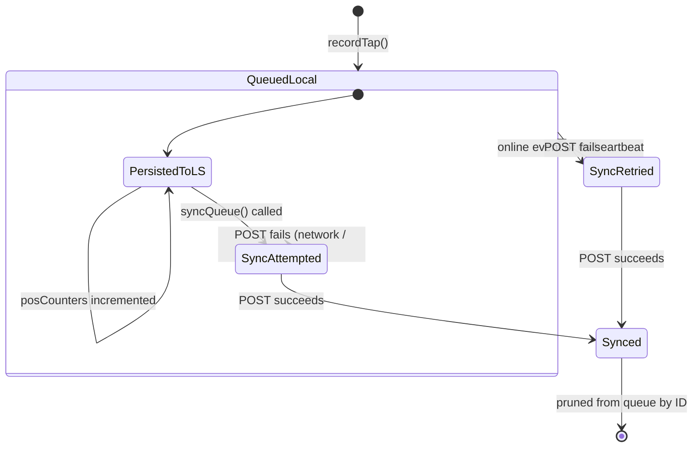
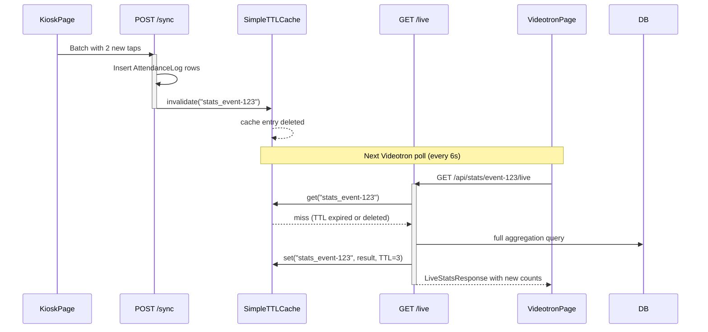

# Offline-First Sync Design

## Overview

The kiosk attendance system must continue recording taps even when the tablet
loses internet connectivity inside a church building. The offline-first sync
architecture achieves this by recording every tap into a local Zustand queue
with a client-generated UUID, persisting the queue across page reloads via
`localStorage`, and asynchronously flushing the queue to the server when
connectivity is available. The server uses the UUID as an idempotency key to
guarantee that exactly one `AttendanceLog` row is created per tap, even if the
same batch is sent multiple times.

<!-- openwiki: mermaid parse failed and this diagram was converted to a text fence so it does not break rendering. Fix the diagram source and restore the mermaid fence. Parser error: Heuristic: an unescaped angle bracket inside a label breaks rendering; rephrase the label. -->
```text
sequenceDiagram
    participant Usher as Petugas Kiosk
    participant Kiosk as KioskPage
    participant Store as offlineQueueStore
    participant LS as localStorage
    participant API as FastAPI Backend
    participant DB as SQLite/MySQL

    Note over Usher,DB: Tap Recording (always succeeds, < 5ms)
    Usher->>Kiosk: touches choice button
    activate Kiosk
    Kiosk->>Store: recordTap(posToken, choiceCode)
    activate Store
    Store->>Store: crypto.randomUUID()
    Store->>Store: increment posCounters
    Store->>LS: persist queue + counters
    Store-->>Kiosk: state updated
    deactivate Store
    Kiosk-->>Usher: visual + audio + haptic feedback (500ms cooldown)
    deactivate Kiosk

    Note over Usher,DB: Background Sync (fire-and-forget)
    Store->>Store: syncQueue(posToken)
    activate Store

    alt Online + success
        Store->>API: POST /api/counter/{token}/sync
        activate API
        API->>DB: check existing IDs (idempotency)
        API->>DB: bulk_save_objects (new only)
        API->>DB: commit
        API-->>Store: { synced_count, already_existed_count }
        deactivate API
        Store->>LS: prune synced IDs from queue
        Store-->>Kiosk: isSyncing=false, lastSyncSuccess updated
    else Offline or failure
        Store->>Store: keep item in queue
        Store-->>Kiosk: isSyncing=false, lastSyncError set
        Note over Store: retry via heartbeat (6s) or online event
    end
    deactivate Store
```

*Caption: Sequence of a tap from usher action through local persistence,
optimistic sync attempt, and either queue pruning on success or retry-on-failure.*

## Core data model for the queue

### TapQueueItem (frontend, persisted)

| Field | Type | Source | Purpose |
|---|---|---|---|
| `id` | `string` (UUIDv4) | `crypto.randomUUID()` | Idempotency key, primary key of `AttendanceLog` |
| `posToken` | `string` | Route param `/pos/{token}` | Identifies which POS this tap belongs to |
| `choiceCode` | `'PAROKI_BINTARO' | 'LUAR_PAROKI'` | User choice | The attendance category |
| `clientTimestamp` | `string` (ISO 8601) | `new Date().toISOString()` | Client-side timestamp for time-series aggregation |
| `metadata` | `Record<string, any>` (optional) | Caller supplied | Extensible: `{ screen_width, source }` etc. |

Source: `repo://frontend/src/types.ts#L119-L125`

### TapItem (server-side request schema)

```python
class TapItem(BaseModel):
    id: str  # Matches TapQueueItem.id
    choice_code: str
    client_timestamp: datetime
    metadata: Optional[Dict[str, Any]] = None
```

Source: `repo://app/schemas.py#L129-L133`

### BatchSyncRequest

```python
class BatchSyncRequest(BaseModel):
    taps: List[TapItem]
```

Source: `repo://app/schemas.py#L135-L136`

### AttendanceLog (server-side database row)

The `id` column is the client-generated UUID, used as the database primary key
for idempotent deduplication:

```python
class AttendanceLog(Base):
    __tablename__ = "attendance_logs"
    id = Column(String(64), primary_key=True)  # Client UUID
    event_id = Column(...)
    pos_id = Column(...)
    choice_code = Column(String(64), nullable=False)
    client_timestamp = Column(DateTime, nullable=False)
    server_timestamp = Column(DateTime, default=datetime.utcnow)
    metadata_json = Column(Text, nullable=True)
```

Source: `repo://app/models.py#L79-L91`

## Component responsibilities

### offlineQueueStore (Zustand store with persist middleware)

**File:** `repo://frontend/src/store/offlineQueueStore.ts`

The store uses `zustand/middleware` `persist` to survive page reloads. Only
`queue` and `posCounters` are persisted via `partialize`; transient sync
state (`isSyncing`, `isOnline`, `lastSyncError`, `lastSyncSuccess`) is
re-derived on each page load.

```typescript
persist(
  (set, get) => ({ ... }),
  {
    name: 'paroki-kiosk-offline-queue',
    partialize: (state) => ({
      queue: state.queue,
      posCounters: state.posCounters,
    }),
  }
)
```

Source: `repo://frontend/src/store/offlineQueueStore.ts#L176-L182`

**State shape:**

| Property | Type | Persisted | Purpose |
|---|---|---|---|
| `queue` | `TapQueueItem[]` | Yes | Unsent tap records |
| `posCounters` | `Record<string, PosSessionCounter>` | Yes | Optimistic per-POS tallies |
| `isOnline` | `boolean` | No | Derived from `navigator.onLine` |
| `isSyncing` | `boolean` | No | Guards concurrent syncs |
| `lastSyncError` | `string | null` | No | Transient error UI |
| `lastSyncSuccess` | `string | null` | No | Transient success UI |

Source: `repo://frontend/src/store/offlineQueueStore.ts#L46-L52`

#### recordTap method

1. **Haptic feedback:** `navigator.vibrate(35)` if available.
2. **Audio chime:** Plays a D5-A5 harmonic 2-tone chime via Web Audio API.
3. **ID generation:** `crypto.randomUUID()` with fallback to
   `${Date.now()}-${Math.random().toString(36).substring(2, 9)}` for older
   browsers.
4. **Optimistic counter update:** Increments `posCounters[posToken]` for
   `total`, `paroki_bintaro`, or `luar_paroki`.
5. **Queue append:** Pushes `TapQueueItem` to `queue` and persists.
6. **Background sync trigger:** Calls `syncQueue(posToken)` (without `await`)
   so sync proceeds asynchronously.

Source: `repo://frontend/src/store/offlineQueueStore.ts#L72-L113`

#### syncQueue method

- **Guard 1:** Returns early if `isSyncing` is already `true` -- prevents
  concurrent sync requests.
- **Guard 2:** Returns early if there are no pending taps for the given POS
  token.
- Sets `isSyncing = true` and `lastSyncError = null`.
- POSTs the batch to `/api/counter/{token}/sync` with
  `Content-Type: application/json`.
- **On success:** Filters the synced UUIDs out of the queue and sets
  `isOnline = true`, `lastSyncSuccess = current time`.
- **On failure:** Keeps the items in the queue, sets `isOnline` to current
  `navigator.onLine`, records `lastSyncError`, and resets `isSyncing` so the
  heartbeat or online event can retry.

Source: `repo://frontend/src/store/offlineQueueStore.ts#L115-L165`

### KioskPage (React component)

**File:** `repo://frontend/src/pages/KioskPage.tsx`

#### Connectivity management

```typescript
useEffect(() => {
  const handleOnline = () => {
    setOnlineStatus(true);
    syncQueue(token);
  };
  const handleOffline = () => {
    setOnlineStatus(false);
  };

  window.addEventListener('online', handleOnline);
  window.addEventListener('offline', handleOffline);

  const interval = setInterval(() => {
    if (navigator.onLine && pendingCount > 0 && !isSyncing) {
      syncQueue(token);
    }
  }, 6000);

  return () => {
    window.removeEventListener('online', handleOnline);
    window.removeEventListener('offline', handleOffline);
    clearInterval(interval);
  };
}, [token, pendingCount, isSyncing, setOnlineStatus, syncQueue]);
```

Source: `repo://frontend/src/pages/KioskPage.tsx#L69-L93`

Key behaviors:
- **Immediate retry on connectivity recovery:** The `online` event fires and
  calls `syncQueue(token)` instantly.
- **Periodic heartbeat:** A `setInterval` every 6 seconds checks if
  `navigator.onLine` is true, there are pending items (`pendingCount > 0`),
  and no sync is in progress (`!isSyncing`).
- **Cooldown/debouncing:** The `isCooldown` state (set to `true` on tap,
  reset after 500ms) prevents double-taps.
- **Event-completed guard:** If `posInfo.event_status === 'COMPLETED'`, the
  touch buttons are disabled entirely.

#### Visual sync status indicator

The header button shows:
- Amber pulsing badge with pending count when items are queued.
- Green "Online" badge when connected with no pending items.
- Red "Offline" badge when disconnected.
- Spinning refresh icon during active sync.

Source: `repo://frontend/src/pages/KioskPage.tsx#L186-L220`

### Batch sync endpoint (`POST /api/counter/{token}/sync`)

**File:** `repo://app/routers/counter.py#L38-L115`

1. **POS validation:** Queries `EventPos` by `token` and `is_active == True`.
   Returns 404 if invalid.
2. **Event check:** Queries parent `EventSession`. Returns 404 if not found.
3. **Completed-event early exit:** If `event.status == COMPLETED`, returns
   `synced_count: 0` with an informational message.
4. **Idempotency pass:** Extracts all incoming `id` values and queries
   `AttendanceLog.id` for existing matches. Skips any ID already in the
   database.
5. **Batch insert:** Creates `AttendanceLog` objects for new IDs, parses
   `client_timestamp` (handles `Z` suffix), records `server_timestamp` as
   `datetime.utcnow()`, and uses `db.bulk_save_objects()` for efficient
   bulk insertion.
6. **Cache invalidation:** Calls `stats_cache.invalidate(f"stats_{event.id}")`
   to wipe the TTL cache entry for live aggregation.
7. **Response:** Returns `synced_count`, `already_existed_count`,
   `event_status`, and a human-readable message.

Source: `repo://app/routers/counter.py#L38-L115`

### SimpleTTLCache (server-side cache with invalidation)

**File:** `repo://app/cache.py`

A thread-safe in-memory dictionary cache with TTL expiration. Used to cache
live stats aggregations. Default TTL is 3 seconds.

| Operation | Signature | Behavior |
|---|---|---|
| `get(key)` | `-> Optional[Any]` | Returns value if within TTL, deletes expired entries |
| `set(key, value, ttl)` | `-> None` | Stores value with expiration time |
| `invalidate(prefix)` | `-> None` | Deletes all keys starting with prefix (empty prefix clears all) |

Source: `repo://app/cache.py#L5-L34`

## Offline queue lifecycle



*Caption: State transitions of a TapQueueItem from creation through eventual
synchronization, including retry paths via connectivity events and heartbeat.*

## Idempotency guarantee

Both client and server collaborate to ensure exactly-once semantics per tap:

1. **Client generates UUID** (`crypto.randomUUID()`) at tap time. This UUID
   becomes the `AttendanceLog.id` primary key.
2. **Client persists the item** in `localStorage` before attempting any
   network call. The tap is never lost even if the browser crashes before
   the sync fires.
3. **Server deduplicates by ID:** The sync endpoint queries
   `AttendanceLog.id IN (incoming_ids)` and skips rows whose IDs already
   exist.
4. **Client prunes by ID after success:** After receiving a successful
   response, the client filters the queue by the set of IDs it sent,
   removing all matching items. This works correctly even if the server
   reports `synced_count: 0` because the IDs were already present.

**Invariant:** Sending the same batch any number of times produces exactly
one `AttendanceLog` row per tap ID.

## Retry strategy

| Trigger | Mechanism | Delay | Source |
|---|---|---|---|
| `window` `online` event | Immediate call to `syncQueue(token)` | ~0ms | `repo://frontend/src/pages/KioskPage.tsx#L70-L72` |
| Periodic heartbeat | `setInterval` checks `navigator.onLine && pendingCount > 0 && !isSyncing` | 6000ms | `repo://frontend/src/pages/KioskPage.tsx#L82-L86` |
| Post-tap optimistic sync | `recordTap` calls `syncQueue` without `await` | ~0ms (after queue append) | `repo://frontend/src/store/offlineQueueStore.ts#L112` |

## Cache invalidation after sync

When the batch sync endpoint successfully inserts new `AttendanceLog` rows,
it invalidates the live stats cache for that event by calling
`stats_cache.invalidate(f"stats_{event.id}")`. This ensures the next poll
from the Videotron display recomputes aggregation from the database.



*Caption: Cache invalidation triggered by a successful sync, forcing the next
Videotron poll to recompute from the database.*

Source: `repo://app/routers/counter.py#L108`

## Edge cases and invariants

| Scenario | Behavior | Evidence |
|---|---|---|
| **Double-tap within cooldown** | `isCooldown` guard (500ms) rejects second tap. Does not enter `handleTouchChoice`. | `repo://frontend/src/pages/KioskPage.tsx#L97-L98` |
| **Event completed while offline** | Sync endpoint returns `synced_count: 0` with `event_status: COMPLETED`. Client prunes queue by ID anyway. | `repo://app/routers/counter.py#L52-L58` |
| **Network restored with large queue** | `online` event fires `syncQueue` once. Heartbeat catches any items that failed. | `repo://frontend/src/pages/KioskPage.tsx#L70-L72` |
| **Server returns 4xx/5xx** | `syncQueue` catch block: queue unchanged, `isSyncing` reset to `false`, error recorded. | `repo://frontend/src/store/offlineQueueStore.ts#L157-L164` |
| **Concurrent sync for same token** | `isSyncing` flag prevents overlapping requests. | `repo://frontend/src/store/offlineQueueStore.ts#L117` |
| **Browser crash before sync** | Queue is persisted in `localStorage` via Zustand `persist`. All items survive page reload. | `repo://frontend/src/store/offlineQueueStore.ts#L61` |
| **Stale browser tab with old token** | KioskPage validates token on mount via `GET /api/counter/validate/{token}`. Stale tokens return 404, showing an error screen. | `repo://frontend/src/pages/KioskPage.tsx#L43-L53` |
| **Server clock vs. client clock skew** | `client_timestamp` is stored as-is for time-series bucketing. `server_timestamp` is set to `datetime.utcnow()` on the server for audit. | `repo://app/routers/counter.py#L85-L100` |
| **Cache serves stale stats** | TTL is 3 seconds. Sync invalidates cache immediately. Videotron polls every 6 seconds. Maximum staleness: ~6 seconds. | `repo://app/cache.py#L6` |

## Configuration knobs

| Parameter | Default | Location | Purpose |
|---|---|---|---|
| Sync heartbeat interval | 6000ms | `repo://frontend/src/pages/KioskPage.tsx#L82-L86` | Frequency of retry checks |
| Tap cooldown (debounce) | 500ms | `repo://frontend/src/pages/KioskPage.tsx#L100` | Minimum time between successive taps |
| Cache TTL | 3 seconds | `repo://app/cache.py#L6` | How long stats aggregation is cached |
| Zustand persist key | `'paroki-kiosk-offline-queue'` | `repo://frontend/src/store/offlineQueueStore.ts#L177` | localStorage key for queue persistence |
| Haptic feedback duration | 35ms | `repo://frontend/src/store/offlineQueueStore.ts#L76` | Vibration intensity for tap confirmation |
| Audio chime notes | D5 (587Hz) + A5 (880Hz) | `repo://frontend/src/store/offlineQueueStore.ts#L12-L34` | Harmonic tones for tap feedback |

## Extension points

1. **Metadata extensibility:** The `metadata` field on `TapQueueItem` and
   `metadata_json` column on `AttendanceLog` allow adding new data
   (e.g., scanner hardware ID, usher badge number, battery level) without
   schema changes.
2. **Choice code extensibility:** The `choice_code` field is a string, not
   an enum in the database. Adding a new attendance category
   (e.g., `'ANAK_SEKOLAH_MINGGU'`) requires only frontend and schema
   validation changes.
3. **Retry strategy tuning:** The 6-second heartbeat interval and the
   cooldown duration are plain constants in `KioskPage.tsx` and can be
   adjusted independently.
4. **Alternative persistence backend:** Zustand `persist` accepts custom
   storage adapters. The current `localStorage` can be replaced with
   IndexedDB, OPFS, or a remote backend without changing the store logic.
5. **Queue inspection and manual flush:** The store exposes `queue` and
   `posCounters` reactively, so a future admin panel could display pending
   items or force a sync.

## Focused tests

The integration test suite in `repo://tests/test_api.py` covers the server-side
offline sync behavior:

- **`test_create_event_and_counter_flow`** (`repo://tests/test_api.py#L91-L179`):
  Creates an event with capacity warning, validates the POS token, syncs two
  taps (one PAROKI_BINTARO, one LUAR_PAROKI) with client-generated UUIDs,
  verifies `synced_count == 2`, then re-sends the same batch to verify
  `synced_count == 0` and `already_existed_count == 2` (idempotency). Also
  verifies live stats aggregate correctly (total=2, PB=1, LP=1, 50/50
  percentages) and CSV export contains the correct headers.

## Related pages

- [/openwiki/concepts/attendance-flow.md](/openwiki/concepts/attendance-flow.md) --
  end-to-end attendance flow including kiosk, sync, cache, and Videotron.
- [/openwiki/architecture/data-model.md](/openwiki/architecture/data-model.md) --
  detailed ORM model specification.
- [/openwiki/architecture/backend-overview.md](/openwiki/architecture/backend-overview.md) --
  application boot, routing, and middleware.
- [/openwiki/workflows/kiosk-counter.md](/openwiki/workflows/kiosk-counter.md) --
  step-by-step operator workflow for the kiosk usher.
