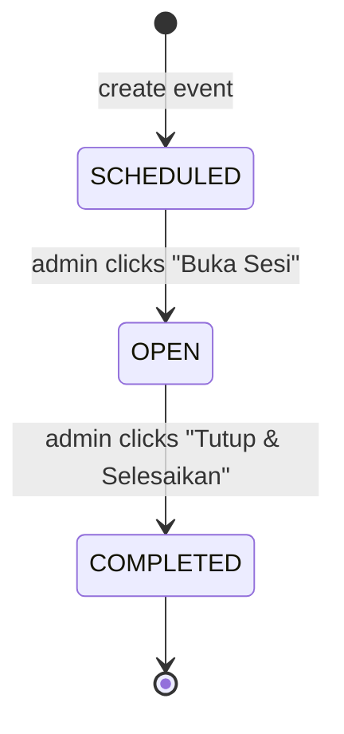
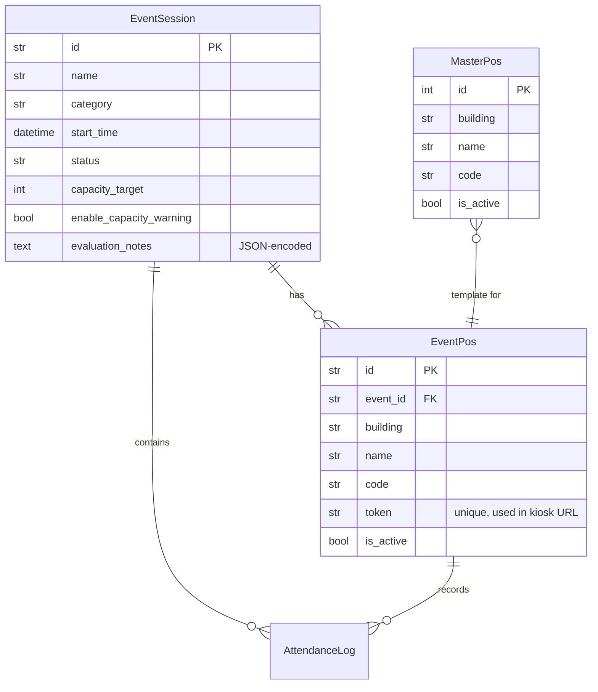

## Ownership and Responsibilities

The admin dashboard subsystem is the primary authenticated interface for the
Penelitian & Pengembangan (Litbang) and IT Administrator teams of Gereja St.
Matius Penginjil Paroki Bintaro. It owns:

- **Event lifecycle** — create, read, update, delete event sessions (masses, rehearsals, seminars).
- **Pos (door/checkpoint) management** — create per-event doors with unique tokens and QR codes; optionally select from the MasterPos template catalog.
- **Live attendance monitoring** — polled real-time statistics aggregated per event, building, and individual pos; includes a 15-minute time-series arrival chart.
- **Capacity warnings** — percentage-based fullness thresholds (75% WARNING, 95% FULL) displayed on the Videotron public screen and the admin dashboard.
- **Official A4 report** — a printable Litbang evaluation report with KPI cards, observation categories, recommendations, conclusion, and signature blocks.
- **Evaluation notes editor** — an interactive modal for editing observation items, recommendations, and conclusions, persisted to the database as JSON.
- **CSV export** — full attendance log download for external analysis.
- **Videotron public display** — links to a fullscreen live-attendance view intended for congregation screens.

The public-facing KioskPage (repo://frontend/src/pages/KioskPage.tsx) and
VideotronPage (repo://frontend/src/pages/VideotronPage.tsx) are separate SPA
routes that require no authentication; they are referenced from the admin UI but
are not part of this integration.

## Entrypoints

### Frontend Pages (React SPA)

| Component | Path | Purpose |
|---|---|---|
| `AdminDashboard` | repo://frontend/src/pages/AdminDashboard.tsx | Event list with create modal, filter by status, per-event door QR chips, action buttons (open/close session, monitor, print, CSV, delete) |
| `EventDetailDashboard` | repo://frontend/src/pages/EventDetailDashboard.tsx | Single-event live monitoring: KPI cards, building breakdown, time-series chart, per-pos breakdown with QR/copy/open actions, add-door form, status toggle |
| `ReportPrintView` | repo://frontend/src/pages/ReportPrintView.tsx | Printable A4 Litbang evaluation report: header, KPI cards, arrival time chart with peak-arrival insight, observation sections, recommendations, pos-door table, conclusion banner, signature blocks, evaluation notes editor modal |
| `QrModal` | repo://frontend/src/components/QrModal.tsx | Modal displaying a QR code (error-correction level H) for a pos token URL, with copy-link, open-kiosk, and print actions |

### Backend API Routers (FastAPI)

| Router | Prefix | Purpose |
|---|---|---|
| `misa.py` | repo://app/routers/misa.py | `GET /api/events`, `POST /api/events`, `GET /api/events/{id}`, `PUT /api/events/{id}`, `PUT /api/events/{id}/status`, `PUT /api/events/{id}/evaluation-notes`, `POST /api/events/{id}/pos`, `DELETE /api/events/{id}` — all protected by `require_litbang_or_admin` |
| `stats.py` | repo://app/routers/stats.py | `GET /api/stats/{event_id}/live` (public, no auth), `GET /api/stats/{event_id}/export/csv` (public download) |

### Navigation Flow

The top-level `App.tsx` (repo://frontend/src/App.tsx) routes via component state, not React Router. The flow is:
1. Unauthenticated → `LoginPage`. On success, `currentTab` is set to `'events'`.
2. Authenticated → `Navbar` with `currentTab` state (`'events'`, `'master-pos'`, `'users'`).
3. `currentTab === 'events'` → `AdminDashboard`.
4. Clicking "Monitor & Pos" on an event → `EventDetailDashboard` (sets `selectedEvent`).
5. Clicking "Cetak PDF" on an event → `ReportPrintView` (sets `reportEvent`).
6. The `/pos/:token` and `/videotron/:eventId` paths are handled before the auth check and render standalone pages without authentication.

## Authentication and Authorization

All admin dashboard API endpoints are protected by the `require_litbang_or_admin` dependency (repo://app/auth.py#L69-L75), which checks that the JWT-authenticated user has role `ADMIN` or `LITBANG`. Token-based auth uses HTTP Bearer headers (`HTTPBearer`). The `getAuthHeaders()` utility reads the token from the Zustand persisted store (repo://frontend/src/store/authStore.ts#L31-L34).

The `stats.py` `/live` and `/export/csv` endpoints intentionally require no authentication because they are consumed by the public Videotron display and by CSV links opened directly from the admin dashboard, respectively.

## Data Model and State Lifecycle

### Event Status Lifecycle

An `EventSession` transitions through three states defined in `EventStatus` (repo://app/models.py#L13-L16):

- `SCHEDULED` — initial state on creation; no attendance recording possible.
- `OPEN` — attendance recording active; KioskPage accepts taps; Videotron shows live stats.
- `COMPLETED` — attendance recording closed; event is read-only.

### Key Entity Relationships

### Pos Creation Strategy

When creating an event, the backend (repo://app/routers/misa.py#L47-L110) resolves pos entries in the following priority order:
1. If `selected_master_pos_ids` is provided: copy from active `MasterPos` records matching the given IDs.
2. Else if `custom_pos_names` is provided: create pos entries with auto-generated codes (`pos-1`, `pos-2`, ...).
3. Else: copy all active `MasterPos` records. If the master table is empty, fall back to four hardcoded defaults (Pintu Utama/Barat, Timur, Utara, Balkon).

Each `EventPos` receives a unique 16-character hex token (repo://app/routers/misa.py#L60) used to construct the kiosk URL: `{origin}/pos/{token}`.

### Evaluation Notes Lifecycle

Evaluation notes are stored as a JSON string in the `evaluation_notes` column of `event_sessions` (repo://app/models.py#L57). The `EvaluationNotes` Pydantic model (repo://app/schemas.py#L82-L86) defines the structure: a list of `ObservationItem` (each with `category` and `note`), optional `recommendations`, `conclusion`, and `photo_url`.

The `PUT /api/events/{event_id}/evaluation-notes` endpoint (repo://app/routers/misa.py#L183-L200) stores the JSON-serialized payload. The `ReportPrintView` frontend component initialises default observations (Tata Ruang, Tata Laksana, Audio-Visual) and overwrites them with server-side values if available (repo://frontend/src/pages/ReportPrintView.tsx#L49-L64).

## Mechanisms and Control Flow

### Live Statistics Aggregation

The `GET /api/stats/{event_id}/live` endpoint (repo://app/routers/stats.py#L19-L144) computes:
- **Total attendance**: count of all `AttendanceLog` records for the event.
- **Paroki Bintaro / Luar Paroki breakdown**: count by `ChoiceCode` (repo://app/models.py#L18-L20).
- **Capacity percentage**: if `enable_capacity_warning` is true and `capacity_target` is set, thresholds at 75% (WARNING) and 95% (FULL).
- **Per-pos breakdown**: `PosStatItem` list with total, Paroki Bintaro, and Luar Paroki per pos.
- **Per-building breakdown**: aggregated `BuildingStatItem` list with total, per-group counts, and pos count.
- **Time series**: 15-minute buckets based on `client_timestamp` minute-floor division, sorted chronologically.

### Caching

Live stats are cached using `SimpleTTLCache` (repo://app/cache.py#L6-L37) with a default TTL of 3 seconds (repo://app/config.py#L18). The cache key is `stats_{event_id}`. On any mutable event operation (update, status change, evaluation notes save, pos add/delete, event delete), the cache is invalidated for that event key via `stats_cache.invalidate(f"stats_{event_id}")`.

### Polling

The `EventDetailDashboard` polls `GET /api/stats/{event_id}/live` every 6 seconds (repo://frontend/src/pages/EventDetailDashboard.tsx#L73). The `VideotronPage` also polls at the same interval.

### Time-Series Chart Rendering

The `EventDetailDashboard` uses Recharts `LineChart` and `BarChart` components, with a toggle between line and bar views (repo://frontend/src/pages/EventDetailDashboard.tsx#L337-L360). The `ReportPrintView` renders a `LineChart` with `LabelList` value labels on data points, and computes the peak arrival interval from the time-series data (repo://frontend/src/pages/ReportPrintView.tsx#L144-L146).

### QR Code and Kiosk Links

The `QrModal` component (repo://frontend/src/components/QrModal.tsx) renders an SVG QR code using the `qrcode.react` library at error-correction level H. The encoded URL is `{origin}/pos/{token}`. The modal provides copy-to-clipboard, open-in-new-tab, and print actions. It is accessible from both `AdminDashboard` (per-event pos grid chips) and `EventDetailDashboard` (per-pos action buttons).

## Invariants and Failure Modes

| Invariant | Enforcement | Failure handling |
|---|---|---|
| Only ADMIN/LITBANG can create/update/delete events | `require_litbang_or_admin` in `auth.py` | Returns 403 Forbidden |
| Status transitions are restricted to SCHEDULED, OPEN, COMPLETED | Server-side check in `update_event` and `update_event_status` | Returns 400 with "Status tidak valid" |
| Event deletion cascades to attendance logs and pos | SQLAlchemy `cascade="all, delete-orphan"` on relationships | All child records are deleted |
| Pos token uniqueness | `unique=True, index=True` on `EventPos.token` column (repo://app/models.py#L72) | Constraint violation → 500 error; mitigated by UUID v4 hex generation |
| Attendance log idempotency | Client-side UUID primary key in `AttendanceLog.id` (repo://app/models.py#L82) | Duplicate sync silently returns `already_existed_count > 0` |
| Live stats freshness | TTL cache at 3 seconds, invalidated on writes | Stale data for at most 3 seconds after a write |
| Empty events list | `AdminDashboard` shows placeholder UI | "Belum Ada Event" card with create-action guidance |
| CSV download for non-existent event | 404 check in `export_csv` | Returns 404 with "Event tidak ditemukan" |

## Extension Points

- **Custom pos names**: Event creation supports `custom_pos_names` as an alternative to MasterPos-based selection, allowing ad-hoc door setups for non-standard events.
- **Evaluation notes schema**: The `EvaluationNotes` Pydantic model (repo://app/schemas.py#L82-L86) includes an optional `photo_url` field for future photo attachments in reports.
- **Metadata in attendance logs**: The `AttendanceLog.metadata_json` column (repo://app/models.py#L88) stores arbitrary JSON for future branching or additional tap context (e.g., device ID, temperature check).
- **MasterPos building hierarchy**: The `MasterPos.building` column (repo://app/models.py#L37) enables multi-building church complexes. The three predefined buildings (Gedung Gereja Utama, Gedung Karya Pastoral, Tenda & Selasar Luar) are seeded in `init_db_and_seed()` (repo://app/main.py#L43-L51).
- **Capacity warning thresholds**: The 75%/95% thresholds are hardcoded in `stats.py` (repo://app/routers/stats.py#L46-L49). A future extension could make these configurable per event.

## Configuration and Operations

| Setting | Default | File |
|---|---|---|
| `CACHE_TTL_SECONDS` | 3 | repo://app/config.py#L18 |
| `ACCESS_TOKEN_EXPIRE_MINUTES` | 1440 (24h) | repo://app/config.py#L9 |
| Default door list fallback | 4 doors (Barat, Timur, Utara, Balkon) | repo://app/routers/misa.py#L82-L97 |
| Seeded users | admin@matius.id, litbang@matius.id | repo://app/main.py#L18-L40 |

All settings can be overridden via environment variables or a `.env` file, thanks to `pydantic_settings.BaseSettings` (repo://app/config.py#L5-L20).

## Focused Tests

The test suite at repo://tests/test_api.py covers the admin dashboard subsystem:

- **`test_create_event_and_counter_flow`** (line 91): Full flow — login, create event with capacity target, validate pos token, simulate batch sync (2 taps), verify idempotency, assert live stats breakdowns, assert CSV export content.
- **`test_evaluation_notes_flow`** (line 227): Create event as Litbang, save evaluation notes with observations, recommendations, and conclusion, verify persistence via live stats response, assert JSON round-trip correctness.
- **`test_master_pos_and_user_management`** (line 197): List MasterPos, create new door, delete door.
- **`test_login_and_auth`** (line 75): Login as Litbang, verify token and role, test `/api/auth/me`.
- **`test_spa_fallback_and_static_serving`** (line 181): Verify static file and SPA fallback routing for `/pos/:token` and `/videotron/:eventId`.

Tests use a separate SQLite database (`test_app.db`), a `TestClient`-scoped fixture that overrides the `get_db` dependency, and module-scoped database setup/teardown.
