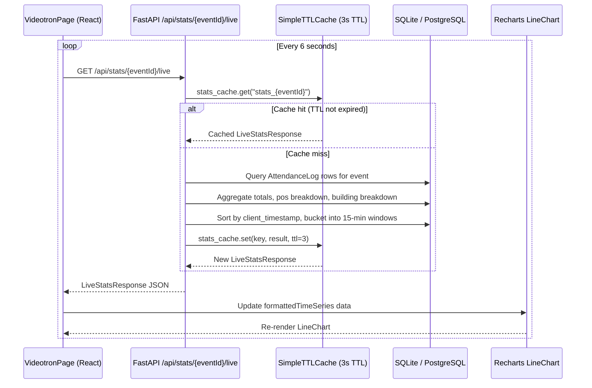

# Videotron Public Display System

The **Videotron Public Display System** is the large-screen projection interface
shown to the congregation during Mass. It renders real-time attendance
statistics aggregated from every kiosk counter at each church entrance. The
system prioritises **low latency** (6-second frontend polling, 3-second backend
TTL cache), **visual impact** (giant odometer-style numbers, animated capacity
alerts, Recharts line charts), and **operational awareness** (building/zone
breakdown, capacity thresholds, Indonesian digital clock).

## Architecture Overview

The videotron display follows a poll-through-cache pattern that protects the
database from repeated aggregation queries:

### Key Design Decisions

- **6-second polling**: The frontend polls every 6 seconds (see
  `frontend/src/pages/VideotronPage.tsx` line 51), giving the congregation a
  near-real-time counter without overwhelming the server.
- **3-second TTL cache**: The backend `SimpleTTLCache` (defined in
  `app/cache.py`, configured via `settings.CACHE_TTL_SECONDS = 3` in
  `app/config.py` line 18) prevents repeated database aggregations within the
  same polling window. On cache hit, the endpoint returns immediately with no
  query.
- **Stateless frontend**: The `VideotronPage` receives only an `eventId` prop,
  extracted from the URL path `/videotron/:eventId` (see `App.tsx` lines 28-30).
  No authentication is required, so the display can run on a projector-connected
  device without login.

## View Modes

The congregation-facing display supports three view modes toggled via buttons
in the header:

### SPLIT Mode (default)

Displays a **compact three-column metrics row** (Total Umat, Paroki Bintaro
count with percentage, Luar Paroki count with percentage) alongside a **time
series line chart** showing the arrival wave over 15-minute intervals. Building
and pos breakdowns appear in the footer.

- Defined at `frontend/src/pages/VideotronPage.tsx` lines 326-417.
- The chart uses Recharts `LineChart` with three lines: total (thick sky-blue
  solid), paroki_bintaro (blue dashed), and luar_paroki (amber dashed).

### NUMBERS Mode

Shows a **giant odometer-style total** (`text-6xl sm:text-8xl md:text-9xl`)
with two split cards below for Paroki Bintaro and Luar Paroki. Each card
contains a large count, percentage badge, and a progress bar.

- Defined at lines 252-322.
- The total is formatted with `toLocaleString('id-ID')` for Indonesian number
  separators.

### CHART Mode

A **full-height, full-width line chart** occupying most of the screen, designed
for projecting during the homily or offertory when the time-series trend is the
main focus.

- Defined at lines 420-493.
- Same Recharts configuration as SPLIT mode but with larger dimensions
  (`h-[480px]`), larger dots, and a header showing total accumulated count.

## Digital Clock & Header

The header displays:
- A `LIVE COUNTER` badge with pulsing red dot.
- The event name from `stats.event_name`.
- **WIB time** (Western Indonesian Time) updated every second via a
  `setInterval` ticker (line 26), formatted with `id-ID` locale.
- The **date** in Indonesian long format (e.g., "Senin, 12 Mei 2025").
- A **fullscreen toggle button** using the Fullscreen API (lines 59-65).

## Capacity Warning System

When an event has `enable_capacity_warning` set and `capacity_target` defined,
the backend computes `capacity_percentage` and sets `capacity_status`:

| Threshold     | Status    | Visual Treatment                                              |
|:--------------|:----------|:--------------------------------------------------------------|
| Below 75%     | `NORMAL`  | Green checkmark, thin emerald progress bar                    |
| 75% - 94.9%   | `WARNING` | Amber gradient banner, `AlertCircle` icon, amber border       |
| 95% and above | `FULL`    | Rose-red gradient banner, `Flame` icon with bounce animation, |
|               |           | `animate-pulse` on the container, bold uppercase percentage   |

- Threshold logic at `app/routers/stats.py` lines 46-49.
- The WARNING banner advises: "Panitia standby untuk pembukaan area selasar
  tambahan."
- The FULL banner instructs: "Petugas / Panitia segera bergegas menyiapkan
  kursi plastik tambahan di selasar & tenda depan gereja."

## Time-Series Bucket Aggregation

The 15-minute arrival wave is built by the backend in `stats.py` lines 93-108:

1. All attendance logs for the event are sorted by `client_timestamp`.
2. Each log is placed in a bucket keyed by `{hour}:{minute_bucket}` where
   `minute_bucket = (ct.minute // 15) * 15` (rounded down to quarter-hour).
3. Each bucket accumulates total, paroki_bintaro, and luar_paroki counts.
4. The sorted buckets become a `List[TimeSeriesBucket]` in the response.

On the frontend, each bucket label is expanded to a range string like
`"16.00-16.15"` for the X-axis (lines 101-112).

## Building / Zone Breakdown

The footer (lines 497-543) contains:

- **Building cards**: One per building in `building_breakdown`, showing building
  name, total, paroki_bintaro count, and luar_paroki count. Each is a
  `bg-blue-950/60` pill with border.
- **Door/Pos breakdown**: A row of small chips, one per `pos_breakdown` entry,
  showing `pos_name: total (PB count / LP count)`.

The building breakdown is computed server-side by grouping `pos_items` by their
`building` field (`stats.py` lines 69-89).

## Backend Cache Layer

The `SimpleTTLCache` (in `app/cache.py`) is an in-memory, thread-safe cache
with:

- `get(key)`: Returns the cached value if within TTL, otherwise deletes it and
  returns `None`.
- `set(key, value, ttl)`: Stores with expiration computed as `time.time() +
  ttl`.
- `invalidate(prefix)`: Clears all keys or keys matching a prefix, used when
  new attendance data arrives to force a fresh aggregation.
- The global `stats_cache` instance has `default_ttl=3` seconds.

## Data Flow & Related Pages

The videotron is the **consumption endpoint** of the attendance pipeline:

1. [Kiosk Counter](../workflows/kiosk-counter.md): The source of attendance
   data. Volunteers tap "Paroki Bintaro" or "Luar Paroki" at each door.
2. [Attendance Flow](../concepts/attendance-flow.md): End-to-end data pipeline
   from kiosk tap to aggregated display.
3. [Backend Overview](../architecture/backend-overview.md): TTL cache
   architecture and database design.
4. [Admin Dashboard](../integrations/admin-dashboard.md): Event management
   interface where events are created, opened, and closed -- the videotron
   display consumes the data those events produce.

## API Contract

### GET /api/stats/{event_id}/live

Returns `LiveStatsResponse` (defined in `app/schemas.py` lines 177-196):

| Field                     | Type                  | Description                                     |
|:--------------------------|:----------------------|:------------------------------------------------|
| `event_id`                | `str`                 | UUID of the event session                       |
| `event_name`              | `str`                 | Human-readable event name                       |
| `category`                | `str`                 | e.g. "Misa"                                    |
| `status`                  | `str`                 | SCHEDULED / OPEN / COMPLETED                    |
| `total_umat`              | `int`                 | Total attendance count                          |
| `paroki_bintaro_count`    | `int`                 | Parishioner count                               |
| `luar_paroki_count`       | `int`                 | Guest count                                     |
| `capacity_percentage`     | `float` or `null`     | Percentage of capacity filled                   |
| `capacity_status`         | `str`                 | "NORMAL" / "WARNING" / "FULL"               |
| `building_breakdown`      | `List[BuildingStatItem]` | Per-building totals                          |
| `pos_breakdown`           | `List[PosStatItem]`   | Per-door totals                                 |
| `time_series`             | `List[TimeSeriesBucket]` | 15-min bucket aggregates                     |
| `last_updated`            | `datetime`            | Server timestamp of response generation         |

The endpoint is defined at `app/routers/stats.py` line 19. It accepts no query
parameters; the `event_id` is a path parameter.

## Configuration

| Setting                  | Default | Location            | Description                        |
|:-------------------------|:--------|:--------------------|:-----------------------------------|
| `CACHE_TTL_SECONDS`      | `3`     | `app/config.py:18`  | Backend cache TTL in seconds       |
| Polling interval         | `6000`  | `VideotronPage.tsx:51` | Frontend fetch interval in ms  |
| Clock tick interval      | `1000`  | `VideotronPage.tsx:26` | Clock update interval in ms    |
| Capacity WARNING         | `75%`   | `stats.py:49`       | Percentage threshold for WARNING   |
| Capacity FULL            | `95%`   | `stats.py:47`       | Percentage threshold for FULL      |

## Error States

- **Loading**: Shown before first successful fetch. Displays a spinning icon
  with "Menghubungkan ke Layar VideoTron..." message.
- **Error / Not Found**: If the API returns a 404 or the fetch throws, an error
  screen with red `AlertCircle` icon and "Data Tidak Ditemukan" is displayed.
- **No data yet**: When `time_series` is empty, the chart areas show "Menunggu
  data kedatangan pertama dari petugas pintu..." or "Menunggu rekaman sentuhan
  dari pintu masuk...".
