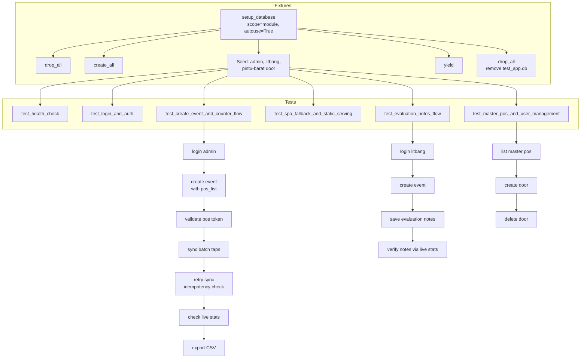

# API Test Suite

## Overview

The API test suite at `repo://tests/test_api.py` is a pytest integration test
suite covering all major API endpoints of the Statistik Kehadiran Umat
application. It runs against an **isolated SQLite database** (`test_app.db`)
created per test run via `Base.metadata.drop_all` / `create_all` and cleaned up
after the module completes. All HTTP requests use `fastapi.testclient.TestClient`
with dependency overrides so no production database is ever touched.



## Test isolation and lifecycle

### Database override

The test suite replaces the production `get_db` dependency with a
`TestingSessionLocal` bound to `sqlite:///./test_app.db` (line 18-29 of
`repo://tests/test_api.py`):

```python
TEST_DATABASE_URL = "sqlite:///./test_app.db"
test_engine = create_engine(TEST_DATABASE_URL, connect_args={"check_same_thread": False})
TestingSessionLocal = sessionmaker(autocommit=False, autoflush=False, bind=test_engine)

app.dependency_overrides[get_db] = override_get_db
```

No Alembic migrations run; tables are created directly from
`Base.metadata.create_all`, matching the production schema exactly because the
same `Base` declarative base is used.

### Autouse module-scoped fixture (`setup_database`)

**Source:** `repo://tests/test_api.py#L31-L66`

- **Scope:** `module` — runs once before any test method, shared across all tests
  in the file.
- **`autouse=True`** — no test needs to declare it as a dependency.
- **Clean slate:** `Base.metadata.drop_all(bind=test_engine)` before and after
  the module.
- **Seed data:** Inserts exactly one admin user, one litbang user, and one master
  pos door (`"Pintu Barat / Utama"` with code `"pintu-barat"`).
- **Teardown:** After all tests finish, drops all tables and removes
  `test_app.db` from disk.

### Seed data invariants

| Entity | Email / Code | Password | Role |
|---|---|---|---|
| Admin user | `admin@matius.id` | `AdminMatius2026!` | `ADMIN` |
| Litbang user | `litbang@matius.id` | `LitbangMatius2026!` | `LITBANG` |
| MasterPos door | `pintu-barat` | — | — |

These credentials match the production defaults in `repo://app/config.py#L11-L14`
so the same login payloads work in both development and test.

## Test functions and what they cover

### `test_health_check`

**Source:** `repo://tests/test_api.py#L70-L73`

Sends `GET /api/health` (unauthenticated) and asserts `status == "ok"`,
confirming the FastAPI app boots, the router mounts correctly, and the health
endpoint returns its static response (`repo://app/main.py#L101-L107`).

### `test_login_and_auth`

**Source:** `repo://tests/test_api.py#L75-L89`

Validates the JWT authentication flow:
1. `POST /api/auth/login` with litbang credentials returns `200` and an
   `access_token`.
2. `GET /api/auth/me` with the Bearer token returns the litbang user profile
   with `email == "litbang@matius.id"` and `role == "LITBANG"`.

This covers `repo://app/routers/auth.py#L17-L36` (login) and
`repo://app/routers/auth.py#L38-L40` (me).

### `test_create_event_and_counter_flow`

**Source:** `repo://tests/test_api.py#L91-L179`

This is the **most comprehensive test**, covering the full end-to-end attendance
counting flow:

1. **Login as admin** (`POST /api/auth/login`)
2. **Create an event** (`POST /api/events`):
   - Payload: `"Misa Natal I 2026"`, category `"Misa"`, capacity 1000,
     `enable_capacity_warning=True`, start time in one hour.
   - Asserts the response includes `pos_list` with at least one position
     (auto-populated from the seeded MasterPos door).
   - **Source:** `repo://app/routers/misa.py#L25-L114`
3. **Validate the kiosk POS token** (`GET /api/counter/validate/{pos_token}`):
   - No authentication required — kiosk devices use only the token URL.
   - Asserts the response includes `building` field with non-empty value.
   - **Source:** `repo://app/routers/counter.py#L16-L36`
4. **Sync batch taps** (`POST /api/counter/{pos_token}/sync`):
   - Sends 2 tap records with client-generated UUIDs:
     - One `PAROKI_BINTARO` choice
     - One `LUAR_PAROKI` choice
   - Asserts `synced_count == 2`.
   - **Source:** `repo://app/routers/counter.py#L38-L115`
5. **Idempotency verification** — resends the **exact same batch**:
   - Asserts `synced_count == 0` and `already_existed_count == 2`.
   - This confirms that `AttendanceLog.id` (the client UUID primary key)
     prevents duplicate rows.
   - **Idempotency mechanism:** `repo://app/routers/counter.py#L71-L73` queries
     existing IDs and skips matches.
6. **Check live stats** (`GET /api/stats/{event_id}/live`):
   - Asserts `total_umat == 2`, `paroki_bintaro_count == 1`,
     `luar_paroki_count == 1`, both percentages at 50.0%.
   - Asserts `building_breakdown` is non-empty and the first entry has
     `total == 2`.
   - **Source:** `repo://app/routers/stats.py#L19-L144`
7. **Export CSV** (`GET /api/stats/{event_id}/export/csv`):
   - Asserts HTTP 200 and that the CSV content includes the header columns
     `Gedung_Lokasi` and the choice labels `"Umat Paroki Bintaro"` and
     `"Umat Luar Paroki"`.
   - **Source:** `repo://app/routers/stats.py#L146-L199`

### `test_spa_fallback_and_static_serving`

**Source:** `repo://tests/test_api.py#L181-L195`

Verifies the SPA fallback routing (`repo://app/main.py#L109-L133`):

1. `GET /` returns the index.html with `"Statistik Kehadiran Umat"` in the text.
2. `GET /pos/sample-token-abc` (kiosk path) falls back to `index.html` — the
   string `"root"` (from React's `<div id="root">`) is present in the response.
3. `GET /videotron/some-event-id` (videotron path) also returns `index.html`.

This confirms the catch-all route properly serves the built frontend for all
SPA paths below the root.

### `test_master_pos_and_user_management`

**Source:** `repo://tests/test_api.py#L197-L225`

Covers the MasterPos CRUD operations (admin-only):

1. **Login as admin** to obtain authorization.
2. **List master positions** (`GET /api/master-pos`) — asserts at least 1 door
   (the seeded `pintu-barat`).
   - **Source:** `repo://app/routers/master_pos.py#L12-L21`
3. **Create a new master door** (`POST /api/master-pos`) with unique code
   `"pintu-sayap-kiri"` — asserts HTTP 200 and captures the new ID.
   - **Source:** `repo://app/routers/master_pos.py#L23-L44`
4. **Delete the created door** (`DELETE /api/master-pos/{id}`) — asserts 200.
   - **Source:** `repo://app/routers/master_pos.py#L77-L89`

This test implicitly validates the RBAC: only admin users (not litbang) can
create or delete master positions, as enforced by `require_admin` at
`repo://app/auth.py#L61-L67`.

### `test_evaluation_notes_flow`

**Source:** `repo://tests/test_api.py#L227-L271`

Covers the evaluation notes feature used by the Litbang team for post-event
reporting:

1. **Login as litbang** (who has permission to manage events).
2. **Create an event** (`POST /api/events`) with category `"Misa Mingguan"`.
3. **Save evaluation notes** (`PUT /api/events/{event_id}/evaluation-notes`):
   - Sends `observations` (array of `{category, note}` objects),
     `recommendations`, and `conclusion`.
   - Asserts the response message `"Catatan evaluasi berhasil disimpan"`.
   - **Source:** `repo://app/routers/misa.py#L182-L199`
4. **Verify via live stats** (`GET /api/stats/{event_id}/live`):
   - Asserts `evaluation_notes` is not `None`.
   - Parses the JSON-encoded notes and verifies:
     - 2 observations
     - First observation category is `"Tata Ruang"`
     - Recommendations match the input
   - **Source:** `repo://app/routers/stats.py#L138` passes through
     `event.evaluation_notes` in the response.

This confirms the evaluation notes are persisted to the database, returned via
the stats endpoint, and survive the JSON encode/decode round-trip.

## Idempotency invariant (critical)

The batch sync endpoint guarantees **at-most-once** semantics per tap UUID. The
test suite's idempotency check (`repo://tests/test_api.py#L155-L159`) is the
primary regression guard:

```python
retry_res = client.post(f"/api/counter/{pos_token}/sync", json=batch_payload)
assert retry_res.status_code == 200
assert retry_res.json()["synced_count"] == 0
assert retry_res.json()["already_existed_count"] == 2
```

This prevents double-counting when network interruptions cause the kiosk to
retry a sync that already succeeded. The mechanism lives at
`repo://app/routers/counter.py#L71-L73`.

## Running the tests

```bash
pytest tests/
```

All tests pass against the default SQLite configuration with no external
dependencies (no MySQL, no Redis, no frontend build required). The test file is
at `repo://tests/test_api.py`.

## Architecture summary for maintainers

| Concern | File | Test coverage |
|---|---|---|
| Health endpoint | `repo://app/main.py#L101-L107` | `test_health_check` |
| JWT login + /me | `repo://app/routers/auth.py#L17-L40` | `test_login_and_auth` |
| Event CRUD (create) | `repo://app/routers/misa.py#L25-L114` | `test_create_event_and_counter_flow`, `test_evaluation_notes_flow` |
| Evaluation notes | `repo://app/routers/misa.py#L182-L199` | `test_evaluation_notes_flow` |
| POS token validation | `repo://app/routers/counter.py#L16-L36` | `test_create_event_and_counter_flow` |
| Batch sync + idempotency | `repo://app/routers/counter.py#L38-L115` | `test_create_event_and_counter_flow` |
| Live stats aggregation | `repo://app/routers/stats.py#L19-L144` | `test_create_event_and_counter_flow`, `test_evaluation_notes_flow` |
| CSV export | `repo://app/routers/stats.py#L146-L199` | `test_create_event_and_counter_flow` |
| MasterPos CRUD | `repo://app/routers/master_pos.py#L12-L89` | `test_master_pos_and_user_management` |
| SPA fallback routing | `repo://app/main.py#L109-L133` | `test_spa_fallback_and_static_serving` |
| TTL cache invalidation | `repo://app/cache.py`, `repo://app/routers/counter.py#L108` | (covered indirectly by live stats assertions) |

## Related pages

- [Attendance Counting Flow](/openwiki/concepts/attendance-flow.md) — traces a
  tap from kiosk to videotron, covering the batch sync endpoint and cache
  invalidation
- [Offline-First Sync Design](/openwiki/concepts/offline-sync.md) — detailed
  design of the offline queue, client UUID generation, and retry mechanics
- [Create Event Workflow](/openwiki/workflows/create-event.md) — how events and
  POS positions are created
- [Kiosk Counter Workflow](/openwiki/workflows/kiosk-counter.md) — the kiosk
  interface and tap flow
