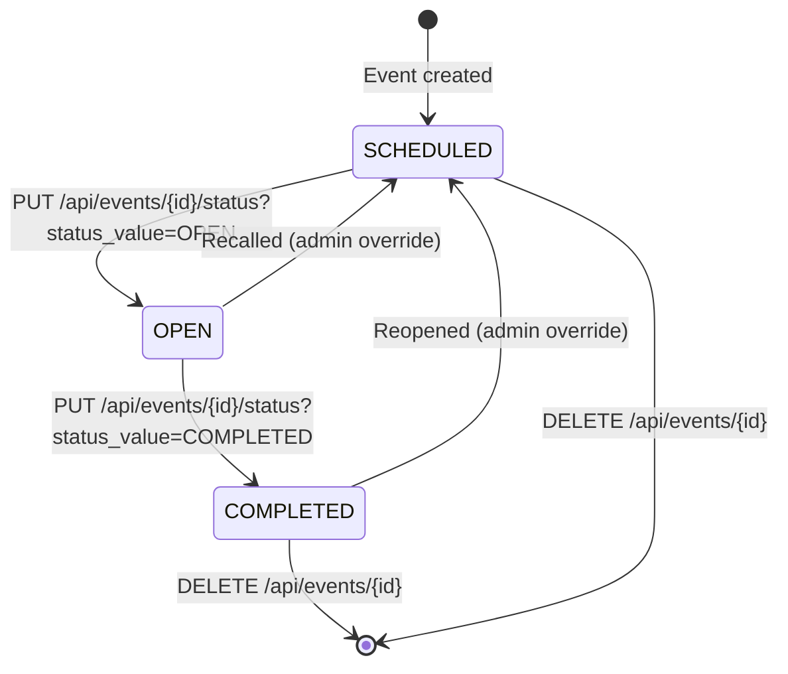

# Create Event Workflow

## Overview

The Create Event workflow is the primary mechanism for defining a new
attendance-counting session (Misa, seminar, rehearsal, etc.). It produces an
`EventSession` record along with a set of per-door `EventPos` instances, each
bearing a unique token that authenticates the door's kiosk page. The event is
always created in `SCHEDULED` status and later transitioned to `OPEN` when the
ushers begin counting, then to `COMPLETED` when the session ends.

**Entrypoints:**

| Layer | Entrypoint | Description |
|-------|-----------|-------------|
| Backend API | `POST /api/events` | JSON create payload, auth required |
| Frontend | AdminDashboard `Create Event` button | Full-screen modal with form |
| Test | `test_create_event_and_counter_flow()` | End-to-end creation + counting |

**Key responsibilities:**

1. Accept event metadata (name, category, time, capacity settings)
2. Select door positions from master catalog, custom names, or the full list
3. Generate per-event `EventPos` copies with unique QR tokens
4. Persist the event and its positions in a single transaction
5. Refresh the dashboard event list after creation

---

## Control Flow

<!-- openwiki: mermaid parse failed and this diagram was converted to a text fence so it does not break rendering. Fix the diagram source and restore the mermaid fence. Parser error: Heuristic: an unescaped angle bracket inside a label breaks rendering; rephrase the label. -->
```text
sequenceDiagram
    actor Admin as Admin/Litbang
    participant UI as AdminDashboard
    participant API as POST /api/events
    participant DB as Database
    participant Cache as Stats Cache

    Admin->>UI: Click "Create Event"
    UI->>UI: Fetch master pos list<br/>GET /api/master-pos?active_only=true
    UI->>Admin: Show create modal with<br/>form fields and door selector
    Admin->>UI: Fill form, select doors, submit
    UI->>API: POST /api/events<br/>{name, category, start_time,<br/> capacity_target, selected_master_pos_ids, ...}
    API->>API: Validate auth (require_litbang_or_admin)
    API->>API: Generate event UUID
    API->>API: Determine door source:<br/>selected masters / custom / all active masters / fallback
    API->>DB: INSERT event_sessions
    API->>DB: INSERT event_pos (one per door)<br/>each with uuid4 token
    API->>DB: COMMIT transaction
    API-->>UI: Return EventSessionResponse<br/>with pos_list[] (includes tokens)
    UI->>UI: Refresh event list<br/>GET /api/events
    UI->>Admin: Show new event in dashboard grid
```

### Door Population Logic

The `create_event` handler at `repo://app/routers/misa.py#L25-L114`
implements a three-branch door selection strategy:

1.  **Selected master positions** (`selected_master_pos_ids` non-empty): query
    `MasterPos` filtered by IDs and `is_active == True`, ordered by building
    then display_order. Create one `EventPos` per match.
2.  **Custom door names** (`custom_pos_names` non-empty): iterate the list,
    generate auto-increment codes (`pos-1`, `pos-2`, …), all assigned to
    building `"Gedung Gereja Utama"`.
3.  **Default / no selection** (both fields absent or empty):
    - If any active `MasterPos` exists, copy all, ordered by building and
      display_order.
    - If the master table is empty, use a hardcoded fallback of four default
      doors covering the main church entry points.

```python
# repo://app/routers/misa.py#L47-L110
def create_event(payload: EventSessionCreate, db: Session, current_user: User):
    event_id = str(uuid.uuid4())
    new_event = EventSession(id=event_id, status=EventStatus.SCHEDULED, ...)
    db.add(new_event)
    db.flush()

    if payload.selected_master_pos_ids:
        master_list = db.query(MasterPos).filter(
            MasterPos.id.in_(payload.selected_master_pos_ids),
            MasterPos.is_active == True
        ).order_by(...)
        for m in master_list:
            pos = EventPos(id=str(uuid.uuid4()), event_id=event_id, token=uuid.uuid4().hex[:16], ...)
            db.add(pos)
    elif payload.custom_pos_names:
        for idx, pos_name in enumerate(payload.custom_pos_names):
            # code=f"pos-{idx+1}", building="Gedung Gereja Utama"
            ...
    else:
        # All active MasterPos, or hardcoded fallback
```

### Token Generation

Each `EventPos` receives a random 16-hex-char token via
`uuid.uuid4().hex[:16]`. This token:

- Serves as the kiosk page URL parameter (`/pos/{token}`)
- Authenticates the batch sync endpoint `POST /api/counter/{pos_token}/sync`
  (no login required; the token is the credential)
- Is rendered as a QR code in the Admin Dashboard for ushers to scan
- Has a UNIQUE database constraint (`repo://app/models.py#L72`)

---

## Request & Response Schema

### EventSessionCreate

`repo://app/schemas.py#L88-L98`

| Field | Type | Required | Default | Description |
|-------|------|----------|---------|-------------|
| `name` | `str` | Yes | — | Human-readable event name |
| `category` | `str` | No | `"Misa"` | Event type (Misa, Gladi Bersih, Seminar, …) |
| `description` | `str` or null | No | `null` | Free-text notes for organizers |
| `start_time` | `datetime` | Yes | — | Scheduled start (ISO 8601) |
| `end_time` | `datetime` or null | No | `null` | Optional end time |
| `capacity_target` | `int` or null | No | `null` | Seat count for capacity warnings |
| `enable_capacity_warning` | `bool` | No | `false` | Enable/disable capacity alerts |
| `selected_master_pos_ids` | `List[int]` or null | No | `null` | MasterPos IDs to clone as doors |
| `custom_pos_names` | `List[str]` or null | No | `null` | Ad-hoc door names (used when master IDs absent) |
| `evaluation_notes` | `str` or null | No | `null` | Pre-filled evaluation JSON (optional) |

### EventSessionResponse

`repo://app/schemas.py#L111-L126`

Returns the full `EventSession` including `pos_list` — an array of
`EventPosResponse` objects each containing:

| Field | Type | Description |
|-------|------|-------------|
| `id` | `str` | UUID of the EventPos |
| `event_id` | `str` | Parent event UUID |
| `building` | `str` | Building/location label |
| `name` | `str` | Door name (copied from MasterPos or custom) |
| `code` | `str` | Machine-readable code |
| **`token`** | `str` | **16-char hex kiosk authentication token** |
| `is_active` | `bool` | Soft-enable flag |
| `created_at` | `datetime` | Creation timestamp |

---

## Status Lifecycle



**Invariants:**

- Every event is created as `SCHEDULED` (`repo://app/routers/misa.py#L39`)
- Status transitions are manual — there is no automatic promotion
- The `update_event_status` handler at `repo://app/routers/misa.py#L163-L180`
  validates the new value against the `EventStatus` enum and invalidates the
  stats cache (`stats_cache.invalidate(f"stats_{event_id}")`)
- The `update_event` handler (`repo://app/routers/misa.py#L127-L161`) also
  accepts a `status` field for bulk updates, applying the same validation

**UI status actions (AdminDashboard):**

- **SCHEDULED → OPEN:** button labeled "Buka Sesi" (green) shown only when
  `ev.status !== 'OPEN'`
- **OPEN → COMPLETED:** button labeled "Tutup Sesi" (amber) shown only when
  `ev.status === 'OPEN'`
- Delete is available at any status, preceded by a confirmation dialog
  (`repo://frontend/src/pages/AdminDashboard.tsx#L150-L164`)

---

## Capacity Warning System

When `enable_capacity_warning` is `true` and a `capacity_target` is set, the
live stats endpoint (`GET /api/stats/{event_id}/live`) computes:

| Threshold | Status | UX behavior |
|-----------|--------|-------------|
| < 75% | `NORMAL` | No warning |
| 75% – 94% | `WARNING` | VideoTron & dashboard show capacity banner |
| >= 95% | `FULL` | Strong alert, suggest opening aisles/tents |

The frontend form (`repo://frontend/src/pages/AdminDashboard.tsx#L485-L519`)
shows a checkbox to enable warnings, and when checked reveals a number input
for the seat target (default: 1200). The help text explains that at 75% and
95% thresholds, "VideoTron & Panitia will display a reminder banner to open
hallway/tent seating."

---

## Frontend Form Structure

The AdminDashboard at `repo://frontend/src/pages/AdminDashboard.tsx` renders a
full-screen modal (`#L410-L633`) with:

1. **Event name** — required text input with placeholder examples
2. **Category** — dropdown (`Misa`, `Gladi Bersih / Pelatihan`, `Pelantikan
   Imamat`, `Seminar / Pembinaan`, `Perayaan Paroki`, `Lainnya`)
3. **Start time** — `datetime-local` input, defaults to now + 1 hour rounded
   to the nearest 15 minutes (`#L84-L91`)
4. **Description** — optional textarea for organizer notes
5. **Capacity settings** — checkbox + conditional number input
6. **Door position selector** — grouped by building, with "Select All" /
   "Deselect All" buttons and per-building zone toggles. On mount, all active
   master doors are pre-selected (`#L75` loads all ids).
7. **Submit** — button reads "Simpan & Buat Sesi" and shows "Menyimpan…"
   while the request is in flight

**On form submission** (`handleCreateEvent` at `#L94-L134`):

- Constructs JSON payload from form state
- Sends `POST /api/events` with `Content-Type: application/json` and auth
  headers
- On success, resets form, closes modal, refreshes event list
- On error, shows `alert()` with the server's error detail

---

## Evaluation Notes (Post-Event)

The `evaluation_notes` column on `EventSession` stores a JSON-encoded
structured evaluation. The dedicated endpoint at
`repo://app/routers/misa.py#L182-L200` accepts an `EvaluationNotes` schema:

```python
# repo://app/schemas.py#L82-L86
class EvaluationNotes(BaseModel):
    observations: List[ObservationItem] = []
    recommendations: Optional[str] = None
    conclusion: Optional[str] = None
    photo_url: Optional[str] = None

class ObservationItem(BaseModel):
    category: str = "Umum"  # "Tata Ruang", "Tata Laksana", "Audio - Visual", "Umum"
    note: str
```

The notes are stored after JSON-serialization via `json.dumps()`. The live
stats response includes the raw JSON string in `evaluation_notes` for the
VideoTron display or admin review.

Evaluation notes are typically written after an event is `COMPLETED`. The
test at `repo://tests/test_api.py#L227-L271` verifies creation of an event,
saving observations, and reading them back through live stats.

---

## Authorization & Security

| Operation | Required Role |
|-----------|---------------|
| Create event | `LITBANG` or `ADMIN` |
| Update event / status | `LITBANG` or `ADMIN` |
| Delete event | `LITBANG` or `ADMIN` |
| Add pos to event | `LITBANG` or `ADMIN` |
| Manage master doors | `ADMIN` only |

Authorization is enforced by the `require_litbang_or_admin` dependency at
`repo://app/auth.py#L69-L74`. Counter endpoints (`/api/counter/*`) are
unauthenticated — the pos token is the sole credential.

---

## Cache Invalidation

Mutations to events invalidate the stats cache using the event-id prefix:

```python
stats_cache.invalidate(f"stats_{event_id}")
```

This affects:

- `update_event` (`repo://app/routers/misa.py#L160`)
- `update_event_status` (`repo://app/routers/misa.py#L179`)
- `update_event_evaluation_notes` (`repo://app/routers/misa.py#L196`)
- `add_pos_to_event` (`repo://app/routers/misa.py#L228`)
- `delete_event` (`repo://app/routers/misa.py#L243`)

The cache is a `SimpleTTLCache` (`repo://app/cache.py`) with a 3-second
default TTL. Invalidation simply removes the key immediately rather than
waiting for TTL expiry.

---

## Related Pages

- [Data Model](/openwiki/architecture/data-model.md) — Entity definitions for
  EventSession, EventPos, MasterPos
- [Attendance Flow](/openwiki/concepts/attendance-flow.md) — How tokens are
  used at the kiosk for counting
- [Kiosk Counter](/openwiki/workflows/kiosk-counter.md) — The usher-facing
  kiosk page that scans/enters the token
- [Admin Dashboard](/openwiki/integrations/admin-dashboard.md) — Dashboard
  overview including event creation
- [Offline Sync](/openwiki/concepts/offline-sync.md) — Batch sync from kiosk
  devices
- [Backend Overview](/openwiki/architecture/backend-overview.md) — Overall
  application architecture
- [API Testing](/openwiki/testing/api-testing.md) — Integration test patterns

---

## Key Source Files

| File | Purpose |
|------|---------|
| `repo://app/routers/misa.py` | Event CRUD routes, including create event logic |
| `repo://app/models.py` | ORM models: EventSession, EventPos, MasterPos |
| `repo://app/schemas.py` | Pydantic request/response schemas |
| `repo://app/auth.py` | Role-based authorization dependencies |
| `repo://app/cache.py` | Stats cache with TTL and invalidation |
| `repo://frontend/src/pages/AdminDashboard.tsx` | React create-event modal |
| `repo://frontend/src/types.ts` | TypeScript interfaces matching server schemas |
| `repo://tests/test_api.py` | Integration test covering creation flow |
